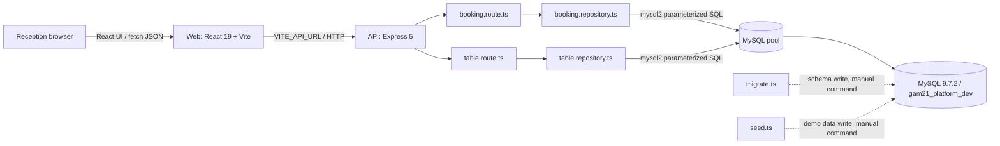
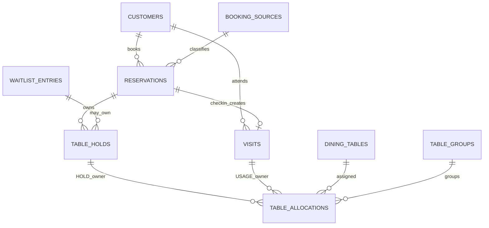

# 21GAM — Project Technical Audit & Context Handover

> Mốc audit: 24/10/2026\
> Repository: `Bar_management`\
> Nhánh khảo sát: `main`\
> Phạm vi ưu tiên: Module Lễ tân — Đặt bàn\
> Hình thức: read-only audit; không migration, seed, sửa database, cài package, commit hay push

## Quy ước mức độ xác nhận

| Nhãn | Ý nghĩa |
| --- | --- |
| **VERIFIED — SOURCE** | Đã kiểm chứng trực tiếp từ source/configuration trong repository. |
| **VERIFIED — RUNTIME** | Đã kiểm chứng bằng lệnh chỉ đọc hoặc HTTP GET trong phiên audit. |
| **REPORTED** | Chỉ xuất hiện trong tài liệu/báo cáo, chưa đủ bằng chứng runtime hoặc source hiện tại. |
| **NOT IMPLEMENTED** | Đã đối chiếu source và xác định chưa có triển khai hoạt động. |
| **UNKNOWN** | Chưa đủ căn cứ hoặc không được phép kiểm tra trong phạm vi read-only. |

Không đọc file `.env` và không thu thập giá trị secret. Danh sách biến cấu hình được lấy từ source và các file `.env.example`.

---

## 1. Executive Summary

21GAM hiện là một monorepo nhỏ gồm React frontend, Express API và MySQL. Code tập trung vào một dashboard điều phối bàn và lifecycle booking tối thiểu. Schema GAM-APP v1.2 khá rộng, có 26 bảng bao phủ multi-tenant, RBAC, customer PII, waitlist, reservation, visit, allocation, audit và idempotency; tuy nhiên API mới sử dụng một phần nhỏ của schema.

Kết luận chính:

1. **VERIFIED — RUNTIME:** MySQL container `mysql:9.7.2` đang healthy; API GET trả 43 vị trí active, 3 bàn `is_spare` và 15 booking cho `2026-10-24`.
2. **VERIFIED — SOURCE/RUNTIME:** GET tables, GET bookings, tạo booking, gán bàn, check-in, cancel, no-show và walk-in đã có code thực thi; các GET đã được kiểm tra runtime. Các mutation không được chạy lại trong audit vì sẽ thay đổi dữ liệu.
3. **VERIFIED — SOURCE:** Trạng thái bàn là derived state từ allocation chưa giải phóng: `USAGE -> IN_USE`, `HOLD -> RESERVED`, không có allocation -> `AVAILABLE`.
4. **VERIFIED — SOURCE:** Gán bàn, check-in, cancel/no-show và walk-in có transaction cùng row locking; reservation dùng `version` để optimistic concurrency. Database còn có unique generated-key để chặn nhiều open claim trên cùng bàn/ngày.
5. **P0:** Không có close visit/release table. Một bàn đã check-in hoặc walk-in không thể được trả qua API/UI.
6. **P0:** Không có authentication/authorization middleware. Mọi request dùng `ACTOR_USER_ID` tĩnh; quyền RBAC mới chỉ tồn tại trong schema.
7. **P0/P1:** API chưa áp dụng quy tắc `zones.is_bookable`, sức chứa, quyền dùng bàn sơ cua, business-date/expected-time consistency và idempotency.
8. **P1:** Frontend chưa có realtime/polling; đổi ngày nhanh có thể gặp response race. Sau mutation lỗi, `requestBooking()` gọi `loadData()` và có thể xóa thông báo lỗi vừa đặt.
9. **VERIFIED — SOURCE:** `docs/api.md` và `docs/database.md` đã stale, mô tả prototype/endpoint cũ và không thể dùng làm source of truth.
10. **VERIFIED — RUNTIME:** Typecheck và lint đạt; test đạt 7/7 nhưng chỉ gồm health endpoint và pure table-state helper, không có database integration test.

Đánh giá readiness: hệ thống phù hợp để demo MVP trong môi trường phát triển có kiểm soát. Hệ thống **chưa sẵn sàng cho một ca vận hành thật hoặc nhiều máy** nếu chưa bổ sung close visit, auth/RBAC, quy tắc bàn, đồng bộ và test tích hợp.

---

## 2. Verified Technology Stack

| Hạng mục | Khai báo trong repo | Phiên bản resolve/runtime | Trạng thái | Bằng chứng |
| --- | --- | --- | --- | --- |
| Monorepo | pnpm workspace | pnpm `11.25.0` | VERIFIED | `package.json`, `pnpm-workspace.yaml`, `pnpm --version` |
| Node.js | `>=24 <25` | Máy audit đang chạy `v25.8.0` | VERIFIED; **mismatch engine** | `package.json`, `api/package.json`, `node --version` |
| Frontend | React + React DOM | `19.3.1` | VERIFIED | `web/package.json`, `pnpm list -r` |
| Bundler | Vite | resolve `8.3.5`; manifest `^8.3.4` | VERIFIED | `web/package.json`, lock/install state |
| Frontend language | TypeScript | `6.0.3` | VERIFIED | `web/package.json` |
| Backend | Express | `5.3.0` | VERIFIED | `api/package.json` |
| DB driver | mysql2 | `3.24.6` | VERIFIED | `api/package.json` |
| Test | Vitest + Supertest | `5.0.5` + `7.3.1` | VERIFIED | `api/package.json`, `api/vitest.config.ts` |
| Lint | ESLint API, Oxlint Web | ESLint `10.13.0`, Oxlint resolve `1.89.0` | VERIFIED | package manifests, installed dependency graph |
| Database | MySQL Docker image | `mysql:9.7.2` | VERIFIED — RUNTIME healthy | `compose.yaml`, `docker compose ps` |
| Schema | GAM-APP v1.2 | 26 domain tables + runtime `schema_migrations` | VERIFIED — SOURCE | `api/database/migrations/0001_initial_schema.sql` |

### Scripts

| Lệnh | Thực hiện | Audit status |
| --- | --- | --- |
| `pnpm dev` | Chạy API và Web song song | Có trong root manifest; không khởi động lại trong audit |
| `pnpm dev:api` / `pnpm dev:web` | Chạy riêng package | VERIFIED — SOURCE |
| `pnpm typecheck` | TypeScript no-emit | VERIFIED — RUNTIME: pass |
| `pnpm lint` | ESLint + Oxlint | VERIFIED — RUNTIME: pass |
| `pnpm test` | Vitest API | VERIFIED — RUNTIME: 2 files, 7 tests pass |
| `pnpm build` | Tạo build output | Không chạy do audit chỉ cho phép ghi file deliverable |
| `pnpm --filter @21gam/api db:migrate` | Chạy SQL migration | Không chạy; có khả năng thay đổi schema |
| `pnpm --filter @21gam/api db:seed` | Nhập demo SQL | Không chạy; thay đổi dữ liệu |

### Biến cấu hình được nhận diện

Không ghi giá trị. Tên biến:

- API/runtime: `NODE_ENV`, `PORT`, `WEB_ORIGIN`, `ORGANIZATION_ID`, `VENUE_ID`, `ACTOR_USER_ID`.
- MySQL client: `DB_HOST`, `DB_PORT`, `DB_NAME`, `DB_USER`, `DB_PASSWORD`.
- Docker MySQL: `MYSQL_DATABASE`, `MYSQL_USER`, `MYSQL_PASSWORD`, `MYSQL_ROOT_PASSWORD`, `MYSQL_PORT`.
- Web: `VITE_API_URL`.

Source: `api/src/config/env.ts`, `.env.example`, `api/.env.example`, `web/.env.example`.

---

## 3. Repository Structure

```text
Bar_management/
├─ api/
│  ├─ database/
│  │  ├─ migrations/0001_initial_schema.sql
│  │  └─ seeds/demo.sql
│  ├─ src/
│  │  ├─ config/env.ts
│  │  ├─ database/{pool,migrate,seed}.ts
│  │  ├─ errors/app-error.ts
│  │  ├─ middleware/{error-handler,not-found}.ts
│  │  ├─ modules/
│  │  │  ├─ bookings/{booking.route,booking.repository}.ts
│  │  │  └─ tables/{table.route,table.repository,table-state}.ts
│  │  ├─ routes/health.route.ts
│  │  ├─ app.ts
│  │  └─ server.ts
│  ├─ test/{health,table-state}.test.ts
│  └─ package.json
├─ web/
│  ├─ public/{21gam-logo.png,favicon.svg}
│  ├─ src/{App.tsx,App.css,index.css,main.tsx}
│  └─ package.json
├─ docs/
│  ├─ api.md
│  ├─ database.md
│  ├─ mysql-setup.md
│  └─ PROJECT_STATUS_2026-10-24.md
├─ compose.yaml
├─ package.json
├─ pnpm-lock.yaml
├─ pnpm-workspace.yaml
└─ README.md
```

Nhận xét:

- Không có `services/`, use-case layer hay domain layer riêng; route gọi repository trực tiếp.
- Frontend không có router, pages, components, API client hoặc hooks tách riêng. Phần lớn logic và UI nằm trong `web/src/App.tsx`.
- `.tools/dbmate.exe` có trên máy audit nhưng bị Git ignore; không phải artifact có thể tái tạo từ repository.
- `verification/fk_lint.sql` được migration nhắc tới nhưng không tồn tại trong repository.
- Các thư mục `.tools/`, `.backups/`, `.env*`, `dist/` được ignore qua `.gitignore`.

---

## 4. System Architecture



### Frontend gọi API

- Base URL lấy từ `VITE_API_URL`, fallback đến URL local trong `web/src/App.tsx` (`apiUrl`).
- `loadData()` chạy song song GET tables và GET bookings theo `businessDate`.
- Mutation dùng `fetch()` trực tiếp trong `requestBooking()` và `submitForm()`; sau thành công gọi lại `loadData()`.
- Không có typed shared contract, request library, cache layer hoặc generated client.

### Backend và MySQL

- `api/src/app.ts` gắn ba router: health, tables, bookings.
- `api/src/database/pool.ts` tạo mysql2 pool, giới hạn 10 connection, UTC session timezone, `utf8mb4`, big integer dạng string.
- `api/src/config/env.ts` chọn organization/venue/actor bằng biến môi trường; không lấy actor từ authenticated request.
- `compose.yaml` chỉ có service MySQL, publish cổng DB trên loopback host; Web/API chạy ngoài Compose.
- Compose đặt MySQL transaction isolation mặc định `REPEATABLE-READ`. Runtime repositories không đổi isolation cho từng transaction.

---

## 5. Database Schema & Relationships

### 5.1 Migration behavior

**VERIFIED — SOURCE:** migration là DDL forward-only, khai báo `transaction:false`. MySQL DDL auto-commit nên failure giữa file có thể để lại schema một phần. `api/src/database/migrate.ts`:

- Tạo `schema_migrations` nếu chưa có.
- Đọc các file `.sql` theo tên tăng dần.
- Tính SHA-256 checksum.
- Từ chối khi file đã chạy nhưng checksum thay đổi.
- Chạy file bằng `multipleStatements` rồi mới ghi migration record.

Không có rollback migration tự động. `verification/fk_lint.sql` được comment yêu cầu nhưng thiếu.

### 5.2 Danh mục toàn bộ bảng

Các index liệt kê dưới đây là PK, unique và index nghiệp vụ quan trọng; migration là nguồn đầy đủ cho mọi index phụ.

| # | Bảng | PK | Unique/index quan trọng | Foreign key chính |
| ---: | --- | --- | --- | --- |
| 1 | `organizations` | `id` | UQ `code` | — |
| 2 | `venues` | `id` | UQ `(organization_id,code)`, `(organization_id,id)` | `organization_id -> organizations` |
| 3 | `users` | `id` | UQ `username` | — |
| 4 | `memberships` | `id` | UQ `(organization_id,user_id)`, `(organization_id,id)`; IX `user_id` | organization, user |
| 5 | `roles` | `id` | UQ `code` | — |
| 6 | `permissions` | `id` | UQ `code` | — |
| 7 | `role_permissions` | `(role_id,permission_id)` | IX `permission_id` | role, permission |
| 8 | `membership_roles` | `id` | UQ active role scope; IX membership/venue/role | membership, venue, role, granting/revoking user |
| 9 | `auth_sessions` | `id` | UQ `token_hash`; IX user, expiry, membership | membership, user |
| 10 | `floors` | `id` | UQ `(venue_id,code)`, `(venue_id,id)` | venue |
| 11 | `zones` | `id` | UQ `(venue_id,code)`, `(venue_id,id)`; IX floor | venue, floor |
| 12 | `dining_tables` | `id` | UQ `(venue_id,code)`, `(venue_id,id)`, bar sequence; IX zone | venue, zone |
| 13 | `table_combinations` | `id` | UQ `(venue_id,code)`, `(venue_id,id)` | venue |
| 14 | `table_combination_members` | `(combination_id,table_id)` | IX composite venue-combination/table | combination, dining table |
| 15 | `customers` | `id` | UQ `(organization_id,id)`, `(organization_id,phone_hmac)`; IX last3/name/merged | organization, merged customer, users |
| 16 | `booking_sources` | `id` | UQ `(organization_id,code)`, `(organization_id,id)` | organization |
| 17 | `visits` | `id` | UQ `(venue_id,id)`; IX business date/open/customer/merged | venue, customer, merged visit, users |
| 18 | `reservations` | `id` | UQ `(venue_id,id)`; IX date+status/name/customer/source/visit | venue, customer, source, visit, users |
| 19 | `waitlist_entries` | `id` | UQ `(venue_id,id)`, one active reservation; IX queue/reservation/visit/customer | venue, reservation, customer, visit, users |
| 20 | `waitlist_table_preferences` | `id` | UQ `(entry_id,pref_rank)`; IX entry/table/combination/zone | venue, entry, table, combination, zone |
| 21 | `waitlist_contact_attempts` | `id` | UQ `(entry_id,attempt_no)`; IX entry/time | venue, entry, user |
| 22 | `table_holds` | `id` | UQ `(venue_id,id)`, one active hold per entry/reservation; IX deadline/owners | venue, reservation, waitlist entry, visit, users |
| 23 | `table_groups` | `id` | UQ `(venue_id,id)`, active symbol per venue/date | venue, users |
| 24 | `table_allocations` | `id` | UQ one active USAGE/table; UQ one open claim/table/date; IX active/report/owners | venue, table, hold, visit, group, users |
| 25 | `operation_log` | `id` | UQ `(venue_id,change_seq)`, compensated operation; IX entity/time/actor/action | organization, venue, actor, prior operation |
| 26 | `idempotency_keys` | `(organization_id,idem_key)` | IX `expires_at` | organization, user |

`schema_migrations` là bảng thứ 27 do `migrate.ts` tạo, không nằm trong DDL nghiệp vụ v1.2.

### 5.3 Quan hệ reservation/visit/table



### 5.4 Business date

`business_date DATE NOT NULL` xuất hiện trên:

- `visits`
- `reservations`
- `waitlist_entries`
- `table_groups`
- `table_allocations`

Schema không tự tính business date bằng trigger. API nhận date từ client và lưu trực tiếp. Seed dùng quy tắc tương đương cutoff 05:00 và có self-check, nhưng frontend `todayInVietnam()` chỉ trả ngày lịch Việt Nam; từ 00:00 đến trước 05:00 nó không tự chọn business date hôm trước.

### 5.5 Trạng thái

| Entity | Trạng thái schema | Code runtime dùng |
| --- | --- | --- |
| Reservation | `BOOKED`, `CHECKED_IN`, `CANCELLED`, `NO_SHOW` | Đủ 4 trạng thái |
| Visit | Open khi `ended_at IS NULL`; closed khi có `ended_at`, `ended_by_user_id`, `end_reason` | Chỉ tạo open visit; chưa có close API |
| Hold | `ACTIVE`, `CONVERTED`, `RELEASED` | ACTIVE khi assign; CONVERTED khi check-in; RELEASED khi cancel/no-show/reassign |
| Allocation | `HOLD`, `USAGE` | Cả hai |
| Table UI | `AVAILABLE`, `RESERVED`, `IN_USE` | Derived, không lưu thành cột state |

Allocation được coi là đang mở khi `released_at IS NULL`. Comment schema xác nhận `released_at` là điều kiện duy nhất giải phóng bàn; deadline của hold chỉ là mốc cảnh báo, không tự trả bàn.

### 5.6 Data integrity và optimistic locking

- `reservations.version` được kiểm tra trong `lockReservation()` sau `SELECT ... FOR UPDATE`, rồi tăng khi assign/check-in/cancel/no-show.
- `dining_tables`, `customers`, `visits`, `waitlist_entries`, `table_holds` cũng có `version`, nhưng runtime hiện không dùng đầy đủ.
- `uq_alloc_one_active_usage` ngăn hai USAGE mở trên cùng bàn.
- `uq_alloc_one_open_claim` ngăn hai allocation open-ended trên cùng bàn và business date.
- `uq_table_holds_active_reservation` ngăn một reservation có nhiều active hold.
- Các CHECK constraints bảo vệ status shape, owner type và release fields.
- Không có database constraint bảo đảm `reservations.business_date = visits.business_date = table_allocations.business_date`; runtime phải giữ invariant này.
- Không có runtime sử dụng `idempotency_keys` hoặc `operation_log` dù schema đã có.

### 5.7 Seed

`api/database/seeds/demo.sql`:

- Chỉ chấp nhận database có hậu tố `_dev`/`_test`, kiểm tra schema nền và dữ liệu trống.
- Chạy trong transaction, có self-check trước COMMIT.
- Dữ liệu tổng hợp; user seed ở trạng thái `DISABLED`, password marker không dùng đăng nhập.
- Phone fields để NULL vì chưa có encryption helper.
- Khai báo 44 vị trí cho venue 1, trong đó BAR21 `OUT_OF_SERVICE`; API chỉ trả 43 active.
- A10, C4, C5 có `is_spare=1` cố định.

Comment “Frontend defaults to its own in-memory seed” trong seed đã stale: frontend hiện gọi API thật.

---

## 6. Backend Modules & API Inventory

Không có service layer riêng. Cột Service vì vậy ghi “—”; route gọi repository trực tiếp.

| Method | Endpoint | Handler | Service | Repository/function | Trạng thái |
| --- | --- | --- | --- | --- | --- |
| GET | `/api/v1/health` | inline `healthRouter.get` | — | — | VERIFIED — RUNTIME; không kiểm DB |
| GET | `/api/v1/tables?date=` | inline `tableRouter.get` | — | `listTables` | VERIFIED — RUNTIME |
| PATCH | `/api/v1/tables/:id/status` | inline `tableRouter.patch` | — | `updateTableState` | Declared nhưng **không thực hiện mutation**; luôn 409 `TABLE_STATE_DERIVED` sau validation |
| GET | `/api/v1/bookings?date=` | inline `bookingRouter.get` | — | `listBookings` | VERIFIED — RUNTIME |
| POST | `/api/v1/bookings` | inline `bookingRouter.post` | — | `createBooking` | VERIFIED — SOURCE; REPORTED runtime từ bàn giao |
| POST | `/api/v1/bookings/walk-ins` | inline route | — | `createWalkIn` | VERIFIED — SOURCE; REPORTED runtime từ bàn giao |
| POST | `/api/v1/bookings/:id/assign` | inline route | — | `assignBookingTables` | VERIFIED — SOURCE; nhận nhiều IDs |
| POST | `/api/v1/bookings/:id/cancel` | inline route | — | `closeBooking(...,'CANCELLED')` | VERIFIED — SOURCE |
| POST | `/api/v1/bookings/:id/no-show` | inline route | — | `closeBooking(...,'NO_SHOW')` | VERIFIED — SOURCE |
| POST | `/api/v1/bookings/:id/check-in` | inline route | — | `checkInBooking` | VERIFIED — SOURCE |

### 6.1 Tạo booking

- Input: `guestName`, positive `partySize`, `expectedAt` string, `businessDate` dạng regex, `sourceCode`, optional `note`.
- Validation: tên non-empty; party size positive integer; source tồn tại/active; `expectedAt` parse được.
- Thiếu validation: date calendar thật trong booking route; max party 500 ở route; expected time thuộc business date; thời gian quá khứ; độ dài trước khi DB reject.
- Tables: đọc `booking_sources`, ghi `reservations`. Không tạo/update `customers`.
- Transaction: không có, vì thao tác ghi chính là một INSERT; không có idempotency.
- Response: HTTP 201 với `BookingView` đọc lại từ DB.
- Errors: `AppError` có code/message; lỗi constraint/driver không map cụ thể và thành generic 500.

### 6.2 Gán một hoặc nhiều bàn / đổi bàn booking trước check-in

- Input: booking id, `version`, `tableIds[]`; duplicate ID được loại bằng `Set`.
- Rules: reservation phải `BOOKED`; ít nhất một bàn; bàn phải ACTIVE; không có allocation mở cùng date.
- Tables: lock/read `reservations`, `dining_tables`, `table_allocations`; release `table_holds`/old allocations; insert hold và HOLD allocations; increment reservation version.
- Transaction: một transaction cho toàn bộ thao tác; rollback khi lỗi; dùng `FOR UPDATE`.
- Concurrency: reservation version + row locks + unique allocation constraints.
- Ngoại lệ thiếu: không kiểm `zones.is_bookable`, capacity, combination, `is_spare` permission, bàn thuộc nhóm hợp lệ; duplicate-key race có thể thành 500 thay vì 409.
- API hỗ trợ nhiều bàn. Frontend chỉ gửi `[selectedTable.id]` nên UI mới hỗ trợ một bàn/lần.
- Gọi assign lại trên reservation BOOKED thực hiện reassign an toàn trong cùng transaction. Đây là đổi bàn **trước check-in**; move visit đang hoạt động chưa có.

### 6.3 Check-in

- Input: booking id và expected `version`.
- Rules: reservation `BOOKED`, có active hold và allocation chưa release.
- Tables: insert `visits`; release HOLD allocations với reason `CONVERTED_TO_USAGE`; convert `table_holds`; insert USAGE allocations; update reservation `CHECKED_IN`, link `visit_id`, increment version.
- Transaction: atomic, rollback khi lỗi, lock reservation và hold allocations.
- Response: booking đã đọc lại, kèm table codes từ USAGE allocations.
- Thiếu: không kiểm current time/early/late policy; không ghi audit/change_seq; không có idempotency; MySQL conflict không được map về domain error.

### 6.4 Cancel / No-show

- Input: booking id + version.
- Rules: chỉ reservation `BOOKED`.
- Tables: release active allocations; set hold RELEASED; set reservation final status/reason/time/user; increment version.
- Transaction và rollback: có.
- Thiếu: không ghi reason từ người dùng; reason được hard-code; không xử lý reservation đã check-in; không audit/idempotency.

### 6.5 Walk-in

- Input: optional `guestName`, positive `partySize`, `businessDate`, `tableIds[]`.
- Rules: ít nhất một active table, không conflict allocation mở.
- Tables: insert `visits(origin='WALK_IN')`, insert USAGE allocations.
- Transaction: có, với table locks và allocation conflict locks.
- Response: chỉ `{ visitId }`.
- Thiếu: không tạo customer; không kiểm capacity/bookable/spare permission; không trả full visit/table view; không idempotency/audit.

### 6.6 Các luồng không có endpoint hoạt động

| Luồng | Trạng thái |
| --- | --- |
| Sửa nội dung booking | NOT IMPLEMENTED |
| Move visit sau check-in | NOT IMPLEMENTED |
| Combine/split visit | NOT IMPLEMENTED |
| Kết thúc visit/trả bàn | NOT IMPLEMENTED |
| Tra cứu tên/ba số cuối | NOT IMPLEMENTED |
| Xuất booking text | NOT IMPLEMENTED |
| Waitlist API | NOT IMPLEMENTED |
| Auth/session/RBAC middleware | NOT IMPLEMENTED |
| Operation log/undo/redo | NOT IMPLEMENTED trong runtime |
| Idempotency middleware | NOT IMPLEMENTED trong runtime |

### 6.7 Error handling

- `AppError` trả `{ error: { code, message } }` với status xác định.
- Lỗi không nhận diện được log server-side và trả 500 message chung.
- 404 có middleware riêng.
- Express body limit 1 MB; CORS chỉ cho `WEB_ORIGIN`; `x-powered-by` bị tắt.
- Không có request ID, structured logging, rate limiting, security headers middleware hoặc centralized MySQL error mapping.

---

## 7. Frontend Architecture & Feature Mapping

### 7.1 Cấu trúc

- Single React root: `web/src/main.tsx`.
- Single screen/component lớn: `web/src/App.tsx`.
- Không có route library hoặc URL routing.
- State management bằng `useState`; derived data bằng `useMemo`; fetch orchestration bằng `useCallback`/`useEffect`.
- CSS toàn cục trong `App.css` và `index.css`.

### 7.2 Feature mapping

| Chức năng | Kết nối API | Tình trạng |
| --- | --- | --- |
| Chọn business date | Có | Reload tables + bookings; chưa áp dụng cutoff 05:00 |
| Sơ đồ bàn | Có, GET tables | Vị trí/state/is_spare từ DB; fixtures/bar decoration vẫn là CSS layout |
| Booking list | Có, GET bookings | Hiển thị mọi status, chưa filter/search |
| Tạo booking dialog | Có, POST booking | Source options hard-code trong JSX thay vì đọc `booking_sources` |
| Walk-in dialog | Có, POST walk-ins | Chỉ một bàn được chọn trên UI |
| Gán bàn | Có, POST assign | Chỉ một bàn/lần trên UI; có thể reassign booking chưa check-in |
| Check-in | Có | Chỉ enabled khi booking có table code |
| Cancel / no-show | Có | Không nhập reason |
| Edit booking | Không | NOT IMPLEMENTED |
| Close visit/release | Không | NOT IMPLEMENTED |
| Search | Không | Button disabled |
| Export text | Không | NOT IMPLEMENTED |
| Waitlist/reports/customers/settings | Không | Navigation placeholder disabled |
| Zone filter/list/time views | Không | Buttons disabled |
| Theme | Local only | Dark/light, lưu `localStorage` |
| Responsive | CSS | Breakpoints 1180/820/560 px |

### 7.3 Loading, error và empty state

- Có loading indicator trên canvas.
- Có empty state cho booking và tables.
- Có banner lỗi kết nối.
- `requestBooking()` khi lỗi gọi `setError(...)` rồi `await loadData()`. `loadData()` ngay lập tức `setError(null)`, vì vậy domain error có thể biến mất trước khi người dùng đọc.
- Tất cả lỗi GET bị gom thành “Không kết nối được API hoặc MySQL”; không phân biệt HTTP lỗi, parse lỗi và network lỗi.
- Không có AbortController hoặc request sequence. Nếu đổi ngày liên tiếp, response cũ có thể hoàn tất sau và ghi đè dữ liệu ngày mới.

### 7.4 Refresh và multi-device

- Refresh sau mutation là full GET tables + bookings.
- Không polling, Server-Sent Events, WebSocket, focus revalidation hay manual refresh button.
- Thay đổi từ thiết bị khác không hiện ra cho tới khi đổi ngày hoặc thực hiện mutation local.

---

## 8. Reservation/Visit/Allocation Lifecycle

### 8.1 Sequence thực tế

```mermaid
sequenceDiagram
    actor R as Receptionist UI
    participant API as Express booking route
    participant Repo as booking.repository
    participant DB as MySQL

    R->>API: POST /bookings
    API->>Repo: createBooking(input)
    Repo->>DB: INSERT reservations(status=BOOKED)
    DB-->>R: BookingView, version=1

    R->>API: POST /bookings/:id/assign {version, tableIds}
    API->>Repo: assignBookingTables
    Repo->>DB: BEGIN; lock reservation + tables
    Repo->>DB: release previous active hold/allocation
    Repo->>DB: check open allocation conflicts
    Repo->>DB: INSERT table_holds(ACTIVE)
    Repo->>DB: INSERT table_allocations(kind=HOLD)
    Repo->>DB: increment reservation.version; COMMIT
    DB-->>R: BOOKED + table codes

    R->>API: POST /bookings/:id/check-in {version}
    API->>Repo: checkInBooking
    Repo->>DB: BEGIN; lock reservation + active HOLD allocations
    Repo->>DB: INSERT visits(open, origin=RESERVATION)
    Repo->>DB: release HOLD allocations
    Repo->>DB: table_holds ACTIVE -> CONVERTED
    Repo->>DB: INSERT USAGE allocations(open)
    Repo->>DB: reservations -> CHECKED_IN + visit_id + version++
    Repo->>DB: COMMIT
    DB-->>R: CHECKED_IN + table codes

    Note over R,DB: Close visit/release USAGE chưa có API/UI
```

### 8.2 Invariants thực tế

1. Reservation chỉ check-in/cancel/no-show/assign khi status `BOOKED`.
2. Mutation reservation yêu cầu version khớp và lock row.
3. Check-in cần ít nhất một active reservation hold allocation.
4. HOLD conversion và USAGE creation ở cùng transaction.
5. Table được xem là bận nếu có allocation `released_at IS NULL` cho business date.
6. `USAGE` phải owner bởi `visit_id`; `HOLD` phải owner bởi `hold_id` — được CHECK constraint bảo vệ.
7. Giải phóng bàn chỉ xảy ra khi set đủ `released_at`, `released_by_user_id`, `release_reason`.
8. Deadline hold không tự giải phóng bàn.
9. Reservation CHECKED_IN buộc phải có visit/time/user qua CHECK constraint.
10. Invariant business-date giữa reservation/visit/allocation do application duy trì, chưa được DB enforce xuyên bảng.

### 8.3 Các nhánh khác

- Cancel/no-show trước check-in: release HOLD + close reservation; không tạo visit.
- Reassign trước check-in: release hold cũ, tạo hold mới trong cùng transaction.
- Walk-in: bỏ qua reservation/HOLD, tạo visit + USAGE trực tiếp.
- Close visit: schema hỗ trợ `visits.ended_*` và release USAGE nhưng runtime chưa triển khai.

---

## 9. Business Rules & Invariants

| Rule | Nơi enforce | Mức độ |
| --- | --- | --- |
| Ngày ca là explicit `business_date` | Schema + API input | Một phần; UI chưa cutoff 05:00 |
| Một active hold/reservation | DB generated unique key | Enforced |
| Một open usage/table | DB generated unique key | Enforced |
| Một open-ended claim/table/date | DB generated unique key | Enforced |
| Reservation version không bị ghi đè | App row lock + expected version | Enforced cho 4 mutation hiện có |
| Chỉ active table được gán | Repository query | Enforced |
| Zone phải bookable | Chưa kiểm trong repository | NOT IMPLEMENTED |
| Capacity đủ party size | Chưa kiểm | NOT IMPLEMENTED |
| Bàn sơ cua cần override/reason | Permission tồn tại trong schema, runtime không kiểm | NOT IMPLEMENTED |
| Bàn sơ cua cố định | `dining_tables.is_spare`; PATCH từ chối sửa | Enforced qua API hiện có |
| Phone được mã hóa/HMAC, receptionist chỉ thấy last3 | Schema hỗ trợ; backend chưa có encryption/auth | NOT IMPLEMENTED runtime |
| Hold quá hạn chỉ cảnh báo, không auto-release | Schema comment/shape | Enforced về mô hình; warning worker chưa có |
| Audit/change sequence trên mọi venue mutation | Schema hỗ trợ | NOT IMPLEMENTED runtime |
| Idempotency cho lệnh ghi | Schema hỗ trợ | NOT IMPLEMENTED runtime |

---

## 10. Implemented Features

### VERIFIED — SOURCE và/hoặc RUNTIME

- Workspace API/Web với scripts dev, lint, test, typecheck, build.
- MySQL Compose local, persistent volume và healthcheck.
- Forward migration runner có checksum.
- Demo seed có guard, transaction và self-check.
- GET tables với state derived từ allocations.
- GET bookings với customer/contact fallback, source và table codes.
- Create booking.
- Assign/reassign một hoặc nhiều tables ở API.
- Check-in reservation: HOLD -> visit + USAGE.
- Cancel và no-show reservation BOOKED.
- Walk-in: visit + USAGE.
- UI date selection, floor map, booking list, create/assign/check-in/cancel/no-show/walk-in.
- Dark/light theme và responsive CSS.
- Fixed spare flag được đọc từ database; A10/C4/C5 có trong seed.
- Error envelope cho AppError và generic 500.
- Graceful shutdown đóng HTTP server và DB pool.

---

## 11. Missing/Incomplete Features

### P0 — chặn vận hành thật

- Close visit/release table.
- Authentication và request-scoped identity.
- Authorization/RBAC enforcement.
- Quy tắc bàn: zone bookable, capacity, spare override.
- Database integration tests cho các mutation quan trọng.
- Cơ chế xử lý MySQL duplicate/deadlock thành lỗi nghiệp vụ có thể retry.

### P1 — hoàn chỉnh module booking

- Edit reservation.
- Move active visit, combine/split tables.
- Multi-select tables trên UI.
- Search theo tên/phone last3.
- Phone encryption/HMAC và customer linkage.
- Export danh sách booking text.
- Waitlist API/UI.
- Late/no-show warning worker.
- Idempotency, operation log, undo/redo, change sequence.
- Đồng bộ nhiều thiết bị.
- Business-date cutoff đúng trên UI/API.

### P2 — mở rộng sản phẩm

- Order/Waiter/Bartender.
- Cashier/payment/invoice.
- Inventory.
- Manager/owner reporting.
- IPOS và tax integration.
- Layout editor.

---

## 12. Concurrency, Security & Data Integrity Risks

| Mức | Rủi ro | Tác động | Bằng chứng/hướng xử lý |
| --- | --- | --- | --- |
| P0 | Không có auth/RBAC | Bất kỳ client truy cập API đều có thể mutation với actor tĩnh | `app.ts` không có auth middleware; `env.actorUserId` dùng trong repositories |
| P0 | Không có close visit | USAGE không thể release qua hệ thống | Không có route/repository function tương ứng |
| P0 | Không enforce bookable/capacity/spare permission | Có thể gán bàn khu không bookable, vượt sức chứa hoặc dùng spare không duyệt | Query assign/walk-in chỉ kiểm ACTIVE |
| P1 | Không idempotency runtime | Retry/bấm đôi có thể tạo reservation/visit trùng | Bảng tồn tại nhưng không được code tham chiếu |
| P1 | Không operation log/change_seq runtime | Không audit, undo, realtime cursor | Bảng/cột tồn tại nhưng repository không ghi |
| P1 | Multi-device stale data | Hai lễ tân nhìn trạng thái khác nhau | Frontend không polling/WebSocket |
| P1 | Race/deadlock/duplicate DB trả generic 500 | Người dùng không biết reload/retry | Error handler không map driver error |
| P1 | UI business date sai sau nửa đêm | Booking 00:00–05:00 có thể vào ngày lịch mới | `todayInVietnam()` không áp dụng cutoff |
| P1 | Node runtime ngoài engine | Local pass nhưng môi trường không đúng contract | engine `<25`, runtime audit `25.8.0` |
| P1 | Dev credentials có fallback trong tracked source/config | Dễ dùng nhầm ngoài dev | `env.ts`, `compose.yaml`; production cần secret injection và fail-closed |
| P1 | Customer PII protection chưa có implementation | Không thể dùng phone thật đúng thiết kế | Schema có cipher/HMAC nhưng API/form không hỗ trợ |
| P2 | Frontend request race | Dữ liệu ngày cũ có thể overwrite ngày mới | `loadData()` không abort/sequence guard |
| P2 | Mutation error bị clear | Người vận hành bỏ lỡ lý do thất bại | `requestBooking()` catch rồi gọi `loadData()` |
| P2 | Health không kiểm DB | API có thể báo OK dù DB hỏng | health route luôn `{ok:true}` |

### SQL injection

**VERIFIED — SOURCE:** giá trị người dùng được truyền bằng parameter binding. Phần SQL động duy nhất là danh sách placeholder `?,?...`, số lượng sinh từ mảng đã parse thành positive integer; không nối trực tiếp giá trị người dùng vào SQL. Không phát hiện SQL injection trực tiếp trong code hiện có.

### Transaction safety

- Assign/check-in/cancel/no-show/walk-in có BEGIN/COMMIT/ROLLBACK/finally release.
- Create booking là một INSERT sau source lookup và không bọc transaction; hợp lý về atomicity cơ bản nhưng không có idempotency.
- Isolation thực tế theo Compose là `REPEATABLE READ`; tài liệu nói READ COMMITTED là không khớp.
- Thứ tự lock nhiều table IDs chưa được chuẩn hóa rõ ràng; concurrent multi-table operations có thể deadlock. Cần sort IDs và retry deadlock.

### Backup/restore

- `.backups/` được ignore, nhưng không có versioned script/policy kiểm chứng restore.
- **REPORTED:** đã có backup cục bộ ở lượt bàn giao trước.
- **UNKNOWN:** backup đó có đầy đủ, còn dùng được và đã restore thử hay chưa; audit không đọc artifact ignored.

---

## 13. Testing & Validation Status

### Đã chạy trong audit

| Kiểm tra | Kết quả |
| --- | --- |
| `pnpm typecheck` | Pass API + Web |
| `pnpm lint` | Pass API + Web |
| `pnpm test` | Pass: 2 files, 7 tests |
| `docker compose ps` | MySQL healthy |
| GET tables ngày 24/10/2026 | 43 active, 3 spare; states AVAILABLE/RESERVED/IN_USE |
| GET bookings ngày 24/10/2026 | 15 rows; đủ BOOKED/CHECKED_IN/CANCELLED/NO_SHOW |

### Test hiện có

- `api/test/health.test.ts`: Supertest health endpoint; không chạm database.
- `api/test/table-state.test.ts`: pure test cho `canTransitionTableState()`.
- Tổng 7 assertions/cases được Vitest báo pass.

### Khoảng trống test

- Không database integration test.
- Không test create/assign/check-in/cancel/no-show/walk-in.
- Không test transaction rollback.
- Không test concurrent assignment, unique conflict hoặc deadlock retry.
- Không test business-date cutoff/timezone.
- Không frontend component/E2E/accessibility test.
- Không test migration trên DB trắng trong phiên audit.
- Không chạy build vì nhiệm vụ chỉ cho phép ghi file audit; build tạo `dist`.

`table-state.test.ts` kiểm một state machine helper hiện không điều khiển PATCH state: `updateTableState()` luôn từ chối mutation. Vì vậy test pass này không chứng minh lifecycle bàn runtime.

---

## 14. Reported vs Verified Discrepancies

| Nội dung bàn giao/tài liệu | Kết quả audit |
| --- | --- |
| Nền tảng, migration, seed hoạt động | Source đầy đủ; runtime DB/API GET hoạt động. Migration/seed không chạy lại trong audit nên việc tái dựng sạch là REPORTED từ lần trước. |
| GET tables/bookings lấy DB | VERIFIED — SOURCE và RUNTIME. |
| Create/assign/check-in/cancel/no-show/walk-in đạt MVP | VERIFIED — SOURCE; mutation runtime không tái chạy vì audit read-only. |
| A10/C4/C5 là spare cố định | VERIFIED — SOURCE trong seed; runtime trả 3 spare. |
| Close/edit/search/export/auth/multi-device chưa xong | VERIFIED — NOT IMPLEMENTED. |
| `docs/api.md`: PATCH table state hoạt động | Sai. Endpoint khai báo nhưng repository cố ý trả 409. |
| `docs/api.md`: booking endpoints mới là “dự kiến” | Stale. Nhiều endpoint đã có thật. |
| `docs/database.md`: prototype có `bookings`, `tables`, `table_daily_states` | Stale. Schema hiện dùng `reservations`, `dining_tables`, `table_allocations`; file tự ghi là prototype cũ. |
| `docs/mysql-setup.md`: transaction ghi READ COMMITTED | Không khớp source. Compose đặt REPEATABLE READ và repository không đổi isolation. |
| `docs/mysql-setup.md`: dbmate có | Có executable local ignored, nhưng workflow đang được README/API package dùng là custom `migrate.ts`; dbmate không được version-control. |
| Seed comment: frontend dùng in-memory seed | Sai với code hiện tại; frontend gọi API. |
| Báo cáo cũ nêu 32 reservations tổng/13 của ngày | Runtime ngày 24/10 audit trả 15 booking. Database đang chạy đã khác mốc báo cáo; nguyên nhân có thể là dữ liệu tạo sau seed hoặc khác ngày seed, nhưng chưa đủ bằng chứng read-only để kết luận. |
| Node.js 24 runtime | Manifest yêu cầu Node 24, nhưng máy audit đang chạy Node 25.8.0. |

Source of truth đề xuất:

1. Migration SQL cho schema.
2. Route/repository code cho behavior API.
3. `App.tsx` cho feature frontend thực tế.
4. Tài liệu này cho snapshot audit 24/10/2026.
5. `docs/api.md` và `docs/database.md` chỉ nên dùng sau khi được cập nhật.

---

## 15. Recommended Development Priorities

### Phase 1 — đóng lifecycle vận hành (P0)

1. Thiết kế `POST /visits/:id/close` hoặc endpoint tương đương:
   - lock visit;
   - kiểm version/open state;
   - set `visits.ended_*`;
   - release toàn bộ USAGE allocations;
   - ghi operation log/change sequence;
   - map conflict thành 409.
2. Bổ sung authentication/session middleware và request actor.
3. Enforce authorization theo permission, đặc biệt spare/override/visit.end.
4. Enforce zone bookable, capacity và spare reason trong assign/walk-in.
5. Viết DB integration tests cho assign/check-in/close/cancel/walk-in và rollback.

### Phase 2 — hoàn chỉnh booking (P1)

1. Edit reservation với expected version.
2. Search customer/reservation, triển khai phone encryption/HMAC/last3.
3. Multi-table UI, move active visit, combine/split.
4. Export text theo format nghiệp vụ.
5. Business-date utility dùng chung API/Web, đúng cutoff 05:00.
6. Idempotency middleware và MySQL error/deadlock retry mapping.

### Phase 3 — nhiều thiết bị và độ tin cậy (P1)

1. Ghi `operation_log` và tăng `venues.change_seq` trong cùng transaction.
2. Polling theo change sequence trước; WebSocket/SSE nếu cần sau.
3. Refresh/focus strategy và stale-write UX trên frontend.
4. Backup tự động, restore drill, DB readiness health, structured logging.
5. Tách migration account và runtime account; bỏ fallback secret ngoài development.

### Phase 4 — module mở rộng (P2)

Waitlist đầy đủ, reporting, waiter/order, cashier, inventory, IPOS/tax và layout editor.

---

## 16. Open Questions Requiring Product/Technical Decisions

1. Chính xác business date của booking 00:00–05:00 được gán theo ngày bắt đầu ca hay cho phép lễ tân chọn khác?
2. `expected_at` có được nằm ngoài cửa sổ ca của `business_date` không?
3. Khu C hiện seed là `is_waiting_area=1`, `is_bookable=0` nhưng có C1/C2/C4/C5. Bàn nào thực sự được phép assign?
4. Ai có quyền dùng A10/C4/C5 và lý do override nào bắt buộc?
5. Capacity là hard block hay warning có override permission?
6. Một booking có thể có nhiều visit hoặc chỉ đúng một visit?
7. Sau check-in có cho cancel reservation hay phải close/entry-error visit?
8. Khi đổi/ghép/tách bàn, lịch sử allocation và group symbol cần hiển thị thế nào?
9. Kết thúc visit có phụ thuộc Cashier/paid status hay Receptionist được trả bàn độc lập?
10. Chuẩn export text cuối cùng và cách tính “khách quen/mới”, “trước/sau 21:30”, “bàn out/hủy” là gì?
11. Quy tắc tìm kiếm tên có bỏ dấu/chuẩn hóa `đ -> d` chính xác ra sao?
12. Key management cho phone AES/HMAC dùng dịch vụ nào và quy trình rotation thế nào?
13. Mô hình triển khai mục tiêu: server tại quán, VPS/cloud hay hybrid? Yêu cầu khi mất Internet?
14. Mức realtime mong muốn và số thiết bị đồng thời dự kiến?
15. API nào của IPOS/hóa đơn điện tử đã được xác nhận chính thức?

---

## 17. Critical File Reference Map

| Chủ đề | File/function chính |
| --- | --- |
| Root scripts/engine | `package.json` |
| Workspace | `pnpm-workspace.yaml` |
| Docker MySQL | `compose.yaml` |
| Environment parsing | `api/src/config/env.ts` |
| DB pool/UTC | `api/src/database/pool.ts` |
| Migration runner/checksum | `api/src/database/migrate.ts` |
| Seed runner | `api/src/database/seed.ts` |
| Official schema | `api/database/migrations/0001_initial_schema.sql` |
| Demo data/guard/spares | `api/database/seeds/demo.sql` |
| Express composition | `api/src/app.ts` |
| Server shutdown | `api/src/server.ts` |
| Booking routes/validation | `api/src/modules/bookings/booking.route.ts` |
| Booking transactions | `api/src/modules/bookings/booking.repository.ts` |
| Reservation lock | `booking.repository.ts::lockReservation` |
| Hold release | `booking.repository.ts::releaseActiveHold` |
| Assign/reassign | `booking.repository.ts::assignBookingTables` |
| Check-in | `booking.repository.ts::checkInBooking` |
| Cancel/no-show | `booking.repository.ts::closeBooking` |
| Walk-in | `booking.repository.ts::createWalkIn` |
| Table routes | `api/src/modules/tables/table.route.ts` |
| Derived table state | `api/src/modules/tables/table.repository.ts::listTables` |
| Disabled direct state update | `api/src/modules/tables/table.repository.ts::updateTableState` |
| Error envelope | `api/src/middleware/error-handler.ts` |
| Frontend orchestration/UI | `web/src/App.tsx` |
| Responsive/theme styling | `web/src/App.css`, `web/src/index.css` |
| Health test | `api/test/health.test.ts` |
| State helper test | `api/test/table-state.test.ts` |
| Stale API document | `docs/api.md` |
| Stale prototype DB document | `docs/database.md` |
| MySQL notes, partially stale | `docs/mysql-setup.md` |

---

## Audit Boundary Confirmation

- Không sửa code nghiệp vụ.
- Không thay đổi schema/migration/seed/database.
- Không chạy migration hoặc seed.
- Không cài hoặc nâng package.
- Không tạo branch, commit, push hoặc merge.
- Không đọc `.env` hoặc tiết lộ secret.
- Các lệnh runtime chỉ gồm status, dependency inventory, typecheck/lint/unit test và HTTP GET.
- File duy nhất được tạo bởi nhiệm vụ audit: `docs/21GAM_PROJECT_CONTEXT.md`.
- `README.md` và `docs/PROJECT_STATUS_2026-10-24.md` đã là thay đổi tồn tại từ lượt trước, không được nhiệm vụ audit này sửa thêm.
