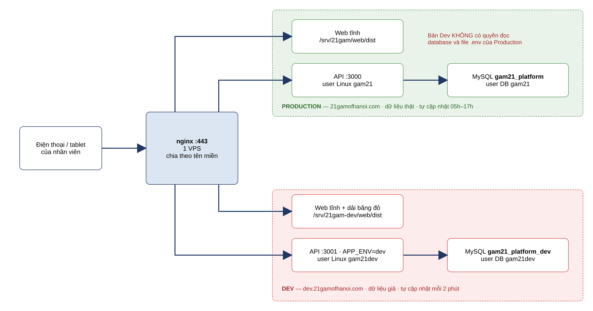

# Bản Dev chạy song song Production (TU-41)

**Tóm tắt.** Bản Dev là bản sao của Production trên **cùng VPS**, tách 5 thứ:
tên miền phụ `dev.21gamofhanoi.com`, thư mục `/srv/21gam-dev`, user Linux
`gam21dev`, cổng API `3001`, database `gam21_platform_dev` với user MySQL riêng
`gam21dev`. Dữ liệu ở Dev là **dữ liệu giả**; không bao giờ chép dữ liệu khách
thật từ Production sang. Mọi màn hình Dev có dải băng đỏ
"MÔI TRƯỜNG DEV — DỮ LIỆU GIẢ" và nút **Đồng hồ Dev** để giả lập giờ trong ca
(mục 11). Dev tự kéo `develop` mỗi 2 phút, kể cả trong giờ quán mở cửa.



(Sơ đồ sửa được: `docs/dev-environment.drawio`.)

| | Production | Dev |
| --- | --- | --- |
| Tên miền | `21gamofhanoi.com` | `dev.21gamofhanoi.com` |
| Thư mục | `/srv/21gam` | `/srv/21gam-dev` |
| User Linux | `gam21` | `gam21dev` |
| Cổng API | 3000 (`21gam-api`) | 3001 (`21gam-api-dev`) |
| Database / user MySQL | `gam21_platform` / `gam21` | `gam21_platform_dev` / `gam21dev` |
| `APP_ENV` | không khai (tự hiểu `production`) | `dev` |
| Cookie phiên | `21gam_session` | `21gam_dev_session` |
| Tự triển khai | `21gam-deploy.timer`, hoãn 17h–05h, có test + backup | `21gam-deploy-dev.timer`, không hoãn, chỉ build + health |
| Máy tìm kiếm | bình thường | chặn (`X-Robots-Tag`, `robots.txt`) |

### Vì sao tách như vậy

* **User MySQL riêng chỉ có quyền trên `_dev`.** Kể cả ai đó điền nhầm
  `DB_NAME=gam21_platform` vào file `.env` của Dev, MySQL vẫn từ chối
  (`SELECT command denied`). Đây là lớp bảo vệ chính cho dữ liệu quán.
* **User Linux riêng.** File `/srv/21gam/api/.env` của Production có quyền
  `600` thuộc `gam21`, nên tiến trình Dev không đọc được mật khẩu database hay
  khoá mã hoá số điện thoại của Production.
* **`APP_ENV` hai chiều.** API từ chối khởi động nếu `APP_ENV=dev` mà database
  không kết thúc bằng `_dev`, hoặc `APP_ENV=production` mà database là
  `_dev`/`_test`. Một file `.env` chép nhầm giữa hai thư mục bị chặn ngay lúc
  khởi động. Code tính năng chỉ dành cho Dev (TU-42 giờ giả lập, TU-43 nút tạo
  dữ liệu mẫu) kiểm tra `env.appEnv === 'dev'`, **không** kiểm tra `NODE_ENV`
  — vì Dev vẫn chạy `NODE_ENV=production` để giữ mọi lớp bảo vệ.
* **Tài khoản tự tách.** Tài khoản nằm trong database; hai database khác nhau
  thì tài khoản Production đăng nhập vào Dev nhận `401 INVALID_CREDENTIALS` và
  ngược lại. Cookie gắn riêng từng tên miền, tên cookie khác nhau là lớp thứ hai.

## 1. Trước khi bắt đầu (5 phút, chỉ đọc)

```bash
free -h            # cần còn trống >= 1 GB RAM khi Production đang chạy
df -h /srv         # cần >= 3 GB trống (mã nguồn + node_modules + build)
sudo grep -E '^(DB_NAME|APP_ENV)=' /srv/21gam/api/.env
```

Dòng cuối **phải** ra `DB_NAME=gam21_platform` và **không** có `APP_ENV`. Nếu
database Production có hậu tố `_dev`/`_test`, dừng lại và báo Tú: bản cập nhật
này sẽ làm API Production từ chối khởi động (auto-deploy sẽ tự lùi code, nhưng
vẫn nên xử lý trước).

RAM không đủ thì báo Hưng trước khi làm tiếp — có thể cần nâng gói VPS.

## 2. Bản ghi DNS (tại Nhân Hòa)

Thêm một bản ghi: loại **A**, tên **dev**, giá trị **đúng IPv4 của VPS** (cùng
IP mà `21gamofhanoi.com` đang trỏ). Kiểm tra:

```bash
dig +short 21gamofhanoi.com
dig +short dev.21gamofhanoi.com      # phải ra cùng IP với dòng trên
```

Chờ đến khi lệnh thứ hai ra IP rồi mới làm mục 6 (certbot). Thường vài phút,
có khi tới vài giờ.

## 3. Database và user MySQL

```bash
DEV_DB_PASS=$(openssl rand -base64 24 | tr -d '/+=' | cut -c1-28); echo "$DEV_DB_PASS"
sudo mysql <<SQL
CREATE DATABASE gam21_platform_dev CHARACTER SET utf8mb4 COLLATE utf8mb4_0900_ai_ci;
CREATE USER 'gam21dev'@'127.0.0.1' IDENTIFIED BY '${DEV_DB_PASS}';
GRANT ALL PRIVILEGES ON gam21_platform_dev.* TO 'gam21dev'@'127.0.0.1';
FLUSH PRIVILEGES;
SQL
```

Ghi mật khẩu vừa in ra vào mục 4. Không cấp thêm quyền nào khác cho `gam21dev`.

## 4. User Linux, mã nguồn, cấu hình, build

```bash
sudo useradd --system --create-home --home-dir /home/gam21dev --shell /bin/bash gam21dev
sudo mkdir -p /srv/21gam-dev && sudo chown gam21dev:gam21dev /srv/21gam-dev
alias asdev='sudo -u gam21dev env HOME=/home/gam21dev'

asdev git clone --branch develop https://github.com/Tusie69/Bar_management.git /srv/21gam-dev
cd /srv/21gam-dev && asdev pnpm install --frozen-lockfile
```

> Trước khi PR TU-41 được merge vào `develop`, clone bằng
> `--branch feature/TU-41-dev-environment`. Sau khi merge: `asdev git checkout develop && asdev git pull`.

API:

```bash
cd /srv/21gam-dev/api
asdev cp ../deploy/env/api.env.dev.example .env && asdev chmod 600 .env
asdev nano .env     # DEV_DOMAIN -> dev.21gamofhanoi.com ; DB_PASSWORD = mật khẩu mục 3
asdev node scripts/init-local-secrets.mjs --env-file .env   # sinh secret + khoá SĐT RIÊNG cho Dev
asdev pnpm build
asdev pnpm db:migrate
asdev pnpm db:seed          # dữ liệu giả: khu, bàn, khách, booking mẫu (chỉ chạy được trên _dev/_test)
```

Tài khoản đăng nhập Dev (lệnh hỏi xác nhận và mật khẩu, phải gõ tay trong
terminal; seed tạo 9 tài khoản mẫu nhưng tất cả đều bị khoá):

```bash
asdev pnpm auth:bootstrap --username admin_dev --display-name "Admin Dev" \
  --organization-id 1 --venue-id 1 --role-code OWNER
```

Tạo tiếp tài khoản Lễ tân/Phục vụ… bằng màn **Tài khoản & phân quyền** trên
Dev. Đặt tên khác Production (VD hậu tố `_dev`) để khỏi nhầm.

Web:

```bash
cd /srv/21gam-dev/web
asdev cp ../deploy/env/web.env.dev.example .env.production
asdev sed -i 's/DEV_DOMAIN/dev.21gamofhanoi.com/' .env.production
asdev pnpm build
```

## 5. Dịch vụ API Dev

```bash
sudo cp /srv/21gam-dev/deploy/systemd/21gam-api-dev.service /etc/systemd/system/
sudo systemctl daemon-reload && sudo systemctl enable --now 21gam-api-dev
curl -s http://127.0.0.1:3001/api/v1/health     # {"ok":true,"appEnv":"dev"}
curl -s http://127.0.0.1:3000/api/v1/health     # Production vẫn sống
```

Log: `sudo journalctl -u 21gam-api-dev -f`.

## 6. Nginx và HTTPS

Không sửa file `21gam.conf` của Production. Bản Dev là một file riêng:

```bash
sudo tee /etc/nginx/sites-available/21gam-dev.conf >/dev/null <<'CONF'
server {
    listen 80;
    server_name dev.21gamofhanoi.com;
    location /.well-known/acme-challenge/ { root /var/www/html; }
    location / { return 404; }
}
CONF
sudo ln -sf /etc/nginx/sites-available/21gam-dev.conf /etc/nginx/sites-enabled/
sudo nginx -t && sudo systemctl reload nginx

sudo certbot certonly --webroot -w /var/www/html -d dev.21gamofhanoi.com \
  --agree-tos --register-unsafely-without-email --non-interactive

sudo sed 's/DEV_DOMAIN/dev.21gamofhanoi.com/g' /srv/21gam-dev/deploy/nginx/21gam-dev.conf.example \
  | sudo tee /etc/nginx/sites-available/21gam-dev.conf >/dev/null
sudo nginx -t && sudo systemctl reload nginx
```

`nginx -t` báo lỗi thì **không** reload — Production vẫn chạy cấu hình cũ. Sửa
xong mới reload.

## 7. Tự triển khai

Chỉ bật **sau khi PR TU-41 đã merge** và `/srv/21gam-dev` đã về nhánh `develop`
(timer luôn kéo `develop`; trước khi merge, `develop` chưa có script này).

```bash
sudo cp /srv/21gam-dev/deploy/systemd/21gam-deploy-dev.* /etc/systemd/system/
sudo systemctl daemon-reload && sudo systemctl enable --now 21gam-deploy-dev.timer
```

Mỗi 2 phút: có commit mới trên `develop` thì kéo về, build api + web, migrate
database Dev, restart, health check phải trả `"appEnv":"dev"`. Build hỏng hoặc
health hỏng thì lùi code. Không sao lưu, không chạy bộ test (cổng test đầy đủ
vẫn chạy ở bản Production sáng hôm sau).

Script tự từ chối chạy nếu `/srv/21gam-dev/api/.env` không có `APP_ENV=dev`
hoặc `DB_NAME` không kết thúc bằng `_dev`.

```bash
journalctl -u 21gam-deploy-dev -n 50                                  # xem log
sudo systemctl start 21gam-deploy-dev.service                         # triển khai ngay
sudo DEPLOY_REBUILD=1 /srv/21gam-dev/deploy/scripts/auto-deploy-dev.sh   # build lại tại chỗ
```

Đổi nhánh Dev tạm thời (VD demo một PR chưa merge): sửa
`Environment=DEPLOY_BRANCH=<nhánh>` trong unit `21gam-deploy-dev.service`, hoặc
chạy tay `sudo DEPLOY_BRANCH=<nhánh> DEPLOY_REBUILD=1 .../auto-deploy-dev.sh`
sau khi `asdev git checkout <nhánh>`. Nhớ trả về `develop`.

## 8. Xoá sạch database Dev

Dùng khi dữ liệu giả rối, migration Dev hỏng, hoặc trước buổi demo.

```bash
sudo systemctl stop 21gam-api-dev
sudo mysql -e "DROP DATABASE gam21_platform_dev;
  CREATE DATABASE gam21_platform_dev CHARACTER SET utf8mb4 COLLATE utf8mb4_0900_ai_ci;"
cd /srv/21gam-dev/api && asdev pnpm db:migrate && asdev pnpm db:seed
asdev pnpm auth:bootstrap --username admin_dev --display-name "Admin Dev" \
  --organization-id 1 --venue-id 1 --role-code OWNER
sudo systemctl start 21gam-api-dev
```

Gõ đúng tên `gam21_platform_dev`. Grant của user `gam21dev` vẫn còn (grant gắn
theo tên database), không cần cấp lại. Sau khi xoá, mọi tài khoản Dev khác
cũng mất — tạo lại qua màn Tài khoản.

## 9. Biến môi trường riêng của Dev

| File | Biến | Giá trị Dev | Ghi chú |
| --- | --- | --- | --- |
| `api/.env` | `APP_ENV` | `dev` | Bắt buộc. Bật nhận diện Dev và tính năng TU-42/43 |
| | `NODE_ENV` | `production` | Giữ nguyên lớp bảo vệ như Production |
| | `PORT` | `3001` | Production dùng 3000 |
| | `WEB_ORIGIN` | `https://dev.21gamofhanoi.com` | Sai là đăng nhập xong bị văng / 403 |
| | `DB_NAME` / `DB_USER` | `gam21_platform_dev` / `gam21dev` | Phải có hậu tố `_dev` |
| | `SESSION_COOKIE_NAME` | `21gam_dev_session` | |
| | `SESSION_CSRF_SECRET`, `PHONE_*` | sinh mới bằng `init-local-secrets.mjs` | **Không** chép từ Production |
| `web/.env.production` | `VITE_APP_ENV` | `dev` | Bật dải băng đỏ + tiền tố `[DEV]` ở tiêu đề tab |
| | `VITE_API_BASE_URL` | `https://dev.21gamofhanoi.com` | |

Mẫu đầy đủ: `deploy/env/api.env.dev.example`, `deploy/env/web.env.dev.example`.

## 10. Nghiệm thu (AC thẻ TU-41)

| AC | Cách kiểm |
| --- | --- |
| Truy cập HTTPS tên miền phụ trên điện thoại | Mở `https://dev.21gamofhanoi.com/letan` trên Safari iOS, có ổ khoá |
| CSDL tách biệt | Đếm trước/sau khi tạo + xoá 1 booking trên Dev: `sudo mysql -e "SELECT (SELECT COUNT(*) FROM gam21_platform.reservations) prod, (SELECT COUNT(*) FROM gam21_platform_dev.reservations) dev;"` — chỉ cột `dev` đổi. Thêm: `mysql -u gam21dev -p -h 127.0.0.1 -e "SELECT 1 FROM gam21_platform.users LIMIT 1"` phải báo `SELECT command denied` |
| Đăng nhập chéo bị từ chối | Tài khoản Production đăng nhập ở Dev → "Tên đăng nhập hoặc mật khẩu không hợp lệ"; tài khoản `admin_dev` đăng nhập ở Production → cùng thông báo |
| Dải băng trên mọi cổng | Mở `/admin`, `/letan`, `/thungan`, `/phucvu`, `/chebien` trên Dev: có dải đỏ; mở cùng các cổng trên Production: **không** có |
| Tài liệu | File này |

Thêm: `curl -sI https://dev.21gamofhanoi.com/ | grep -i x-robots` ra
`noindex, nofollow`; realtime vẫn chạy (2 máy cùng mở sơ đồ bàn Dev, đổi trên
máy 1 thì máy 2 đổi theo).

## 11. Đồng hồ giả lập (TU-42)

Nhiều tính năng chỉ chạy trong ca 17:00–05:00 (đặt bàn 19:00–01:00, màu bàn
theo giờ hẹn, gọi món theo Phiên bàn). Bản Dev cho phép "nhảy" giờ của **ứng
dụng** để test bất kỳ lúc nào. Không đụng đồng hồ hệ điều hành của VPS —
Production cùng máy vẫn chạy giờ thật.

**Dùng:** nút đỏ góc dưới trái mọi màn Dev ("Giờ thật 10:31" / "Giả lập
23:30 · 25/11"). Bấm mở bảng: 4 mốc chọn nhanh (17:00 mở ca · 21:50 sắp tới
giờ hẹn · 23:30 cao điểm · 04:55 cuối ca), ô nhập ngày giờ bất kỳ (±31 ngày),
nút **Giờ thật**. Chỉ tài khoản SuperAdmin thấy các nút; vai khác chỉ xem.
Đổi xong mọi máy đang mở tự nhảy giờ và tải lại sơ đồ trong ~2 giây.

**Hoạt động thế nào:** API cộng một độ lệch vào giờ thật. Mọi chỗ code lấy giờ
đi qua `applicationNow()`; phía database, mỗi lần mượn kết nối MySQL API chạy
`SET timestamp = <giờ giả lập>` nên `UTC_TIMESTAMP()`, `NOW()` và giá trị mặc
định `CURRENT_TIMESTAMP` đều thấy giờ giả lập mà không phải sửa câu SQL nào.
Móc này chỉ gắn khi `APP_ENV=dev`. Độ lệch lưu trong `venue_settings` (khoá
`dev_clock`), giữ nguyên qua mỗi lần tự triển khai.

**Giữ giờ thật có chủ ý:** hạn phiên đăng nhập (nhảy lên 14 tiếng không làm cả
nhóm bị đăng xuất), giới hạn tần suất xem SĐT, bộ nhớ đệm.

**Lưu ý khi test:**
- Dữ liệu tạo ở giờ giả lập mang giờ giả lập (`created_at` 23:30 dù thật là
  10h sáng). Lùi giờ về trước lúc tạo thì có thể thấy dữ liệu "từ tương lai" —
  bình thường với bản Dev; muốn sạch thì xoá database Dev (mục 8).
- Worker cắt ngày vận hành chạy theo giờ giả lập: đặt 04:55 rồi để trôi qua
  05:00 là ca bị đóng thật trên database Dev, đúng như quán.
- Sau khi demo xong, bấm **Giờ thật** để người test sau không bị bất ngờ.

API: `GET/PUT /api/v1/dev/clock` — xem docs/api.md mục "Dev clock (TU-42)".

## 12. Khi có sự cố

| Triệu chứng | Nhìn ở đâu |
| --- | --- |
| API Dev không lên, log báo `APP_ENV=dev chỉ được phép…` | `DB_NAME` trong `/srv/21gam-dev/api/.env` thiếu hậu tố `_dev` |
| `Access denied for user 'gam21dev'` | Sai `DB_PASSWORD` hoặc thiếu grant mục 3 |
| `EADDRINUSE :3001` | Có tiến trình khác giữ cổng: `sudo ss -ltnp \| grep 3001` |
| 502 trên Dev | `sudo systemctl status 21gam-api-dev` |
| Không thấy dải băng đỏ | `web/.env.production` thiếu `VITE_APP_ENV=dev`, build lại web |
| Giờ trên Dev lệch mà không ai nhớ đã đổi | Bấm nút đồng hồ góc dưới trái: dòng "… đổi lúc …" nói ai đổi; Nhật ký thao tác có dòng "Đổi giờ giả lập (Dev)". Bấm **Giờ thật** |
| Production chậm khi Dev đang build | Bình thường trong 1–3 phút; build Dev chạy `Nice=15`, I/O `idle`. Kéo dài thì tạm `sudo systemctl stop 21gam-deploy-dev.timer` |

Gỡ hẳn bản Dev: dừng và disable `21gam-deploy-dev.timer`, `21gam-api-dev`;
xoá `/etc/nginx/sites-enabled/21gam-dev.conf` rồi reload nginx;
`DROP DATABASE gam21_platform_dev; DROP USER 'gam21dev'@'127.0.0.1';`;
xoá `/srv/21gam-dev`. Production không bị ảnh hưởng ở bước nào.
