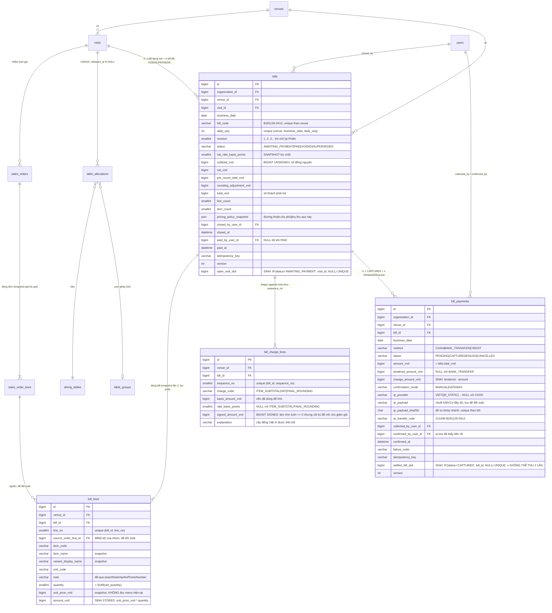

# Kế hoạch TU-45 (Chốt bill) & TU-46 (Thanh toán)

- **Ngày lập:** 2026-11-26
- **Người thực hiện:** Tú · **Review:** Nam
- **Deadline:** TU-45 — Thứ Năm 26/11 21h00 (5 SP / 7h) · TU-46 — Thứ Sáu 27/11 21h00 (5 SP / 8h)
- **Trạng thái:** **TU-45 ĐÃ XONG** (26/11) — xem §16 checklist. **TU-46 chưa bắt đầu.**
  Mọi câu hỏi ở §15 đã được chốt **theo đề xuất mặc định** (26/11, Tú xác nhận); bảng chốt ở §0.
- **Nhánh:** `develop` (tự deploy production — mọi migration phải an toàn khi chạy tiến)
- **Phụ thuộc trước:** HU-43 (họp Thứ Tư 25/11), HU-44 (luồng/US v1.1), CH-02 (cổng thanh toán, chờ anh Luân)
- **Chặn sau:** TU-46, NA-45, NA-46, HU-48

## 0. Quyết định đã chốt (26/11) — triển khai theo đúng bảng này

Toàn bộ §15 được chốt **theo đề xuất mặc định**. Bảng này là nguồn duy nhất khi code; §15 giữ
lại phần *vì sao* và các phương án đã loại, để lần review sau không phải suy lại.

| # | Chủ đề | **Đã chốt** |
|---|---|---|
| Q0 | Kiểu dữ liệu tiền | `BIGINT UNSIGNED`, số nguyên đồng VND. Không `DECIMAL`, không float |
| Q1 | Ai chốt bill / thu tiền | **PA-C**: chỉ `OWNER`, `ADMIN`, `CASHIER` qua `payment.collect` đã có. **Không** migration quyền, **không** cấp cho `WAITER` |
| Q2 | VAT | **Một lần trên TỔNG** tạm tính, làm tròn **nửa lên** tới đồng. Tái dùng `vatAmountVnd` |
| Q3 | Làm tròn lên nghìn | **Chỉ ở tổng cuối**, là bước cuối. Lưu `pre_round_total_vnd` + `rounding_adjustment_vnd` riêng |
| Q4 | Giảm giá | **Không làm tuần này** → `IN_DEVELOPMENT`. Ledger dùng `signed_amount_vnd` **có dấu**. **Báo anh Hưng khi HU-43 có kết quả** |
| Q5 | Yêu cầu hủy còn `PENDING` | **Chặn chốt bill** → `409 ORDER_CANCELLATION_PENDING` |
| Q6 | Khách đưa / tiền thừa | **Lưu**: `tendered_amount_vnd` + `change_amount_vnd` (cột sinh). Chặn `CAPTURED` khi đưa thiếu |
| Q7 | Xác nhận thu | Tiền mặt **một bước**. Chuyển khoản **hai bước**: tạo QR (`PENDING`) → `confirm` với `observedTransfer: true` + cờ `MANUAL` + tên người xác nhận |
| Q8 | Mã bill | `B{yyMMdd}-{seq:4}` → `B261126-0412`, seq reset theo **`business_date`**, cấp dưới khoá dòng `visits` |
| Q9 | Tài khoản nhận tiền QR | 3 hàng `venue_settings` + cờ `is_demo`. Thiếu → `409 PAYMENT_QR_NOT_CONFIGURED`. **Không đặt số liệu mặc định** |
| Q10 | Lượt khách cho cụm ghép | **1 lượt cho cả cụm** (giữ nguyên hành vi C2). Chốt bill ở bàn nào cũng đóng cả cụm; cụm **vẫn giữ viền ghép** sau thanh toán |
| Q11 | Thanh toán từng phần | **Không** trong tuần này. Một bill một phương thức, một giao dịch `CAPTURED` |
| Q12 | Chốt bill rồi khách gọi thêm | Mô hình **`SUPERSEDED` + revision mới**; schema có `bills.revision`. **Endpoint mở lại KHÔNG làm tuần này** → gọi thêm trả `409` kèm `billId` + nhãn "Đang phát triển" |
| Q13 | Tham số preview | Nhận **cả** `?session=` và `?visitId=`; tài liệu khuyến nghị `visitId` |

---

## 1. Ba điều phải thống nhất trước khi đọc tiếp

### 1.1. Tiền: dùng `BIGINT UNSIGNED` số nguyên VND, KHÔNG dùng DECIMAL

Thẻ việc ghi "tiền phải dùng DECIMAL, không dùng float". Mục đích của câu đó — **không
bao giờ dùng floating point cho tiền** — là đúng và kế hoạch này tuân thủ tuyệt đối.
Nhưng *cách* đạt mục đích đó trong repo này đã được chốt từ migration `0036`, và nó là
`BIGINT UNSIGNED` lưu số đồng nguyên:

| Nơi | Kiểu hiện tại |
|---|---|
| `menu_variant_prices.amount_vnd` | `BIGINT UNSIGNED` |
| `sales_order_lines.unit_price_vnd` | `BIGINT UNSIGNED` |
| `sales_order_lines.line_total_vnd` | `BIGINT UNSIGNED AS (unit_price_vnd * quantity) STORED` |
| `sales_order_lines.net_total_vnd` | `BIGINT UNSIGNED AS (unit_price_vnd * (quantity - cancelled_quantity)) STORED` |
| `sales_orders.total_amount_vnd` | `BIGINT UNSIGNED` |
| `venues.vat_rate_basis_points` | `SMALLINT UNSIGNED` (điểm cơ bản: 1000 = 10%) |

Lý do giữ nguyên quy ước, chứ không đổi sang `DECIMAL(13,0)` cho riêng bảng bill:

1. **VND không có đơn vị nhỏ hơn đồng.** `DECIMAL(13,0)` và `BIGINT` biểu diễn đúng cùng
   một tập giá trị; `DECIMAL` không chính xác hơn, chỉ khác tên.
2. **Trộn hai kiểu trong một phép tính là nguồn lỗi thật.** `bill_lines.amount_vnd`
   (DECIMAL) phải cộng khớp từng đồng với `sales_order_lines.net_total_vnd` (BIGINT).
   `mysql2` trả `DECIMAL` về JS dạng **string**, `BIGINT` dạng number/string tuỳ cấu hình —
   mã đối soát sẽ phải `Number(...)` một bên và không bên kia, và đó đúng là chỗ một đồng
   biến mất.
3. **Trần an toàn đã được tính sẵn.** `0036` chốt trần đơn giá 1.000.000.000đ chính xác để
   mọi tổng hợp lệ nằm dưới `Number.MAX_SAFE_INTEGER` (4,95e12 < 9,007e15), nên tiền đi
   qua JSON dạng `number` mà không bị làm tròn âm thầm. Kế hoạch này giữ nguyên trần đó.

**➜ Đề xuất:** dùng `BIGINT UNSIGNED` cho mọi cột tiền của bill. Nếu BA/PO vẫn muốn
`DECIMAL`, nói ngay ở review: đổi được, nhưng phải đổi **cả** `sales_order_lines` trong
cùng sprint, không đổi lẻ một bảng. (Câu hỏi Q0, §13.)

### 1.2. Đã có sẵn trong repo — không dựng lại

| Hạ tầng | Vị trí | Dùng cho bill thế nào |
|---|---|---|
| Bill **tạm tính** (hàm thuần) | `api/src/modules/orders/visit-bill.ts` | Tái dùng `vatAmountVnd`, mở rộng thành `bill-total.ts` |
| Endpoint tạm tính | `GET /api/v1/visits/:visitId/bill` (`order.route.ts:242`) | GIỮ NGUYÊN, không chạm |
| UI tạm tính | `web/src/features/waiter/waiter-bill-sheet.tsx` | Tái dùng `VisitBillBody` cho Màn 3 |
| Chống trùng | `idempotency_keys` (0001) + `api/src/middleware/idempotency.ts` | Dùng y nguyên, **không cần migration mới** |
| Nhật ký | `operation_log` (0001, append-only) + `audit-actions.ts` | Thêm 4 mã hành động |
| Realtime | SSE `floor-changed` + `publishCommittedFloorChange` | Phát sau khi chốt bill / thanh toán |
| Thuế suất | `venues.vat_rate_basis_points` (0045) | Snapshot vào bill lúc chốt |
| Netting hủy món | `sales_order_lines.net_quantity` / `net_total_vnd` STORED | Bill đọc cột net, dòng hủy tự rơi ra |
| Phân quyền | `payment.collect` (0027) — CASHIER/OWNER/ADMIN, **WAITER KHÔNG có** | Xem Q1 |
| Chống SĐT trong ghi chú | `api/src/security/note-privacy.ts` | Áp cho ghi chú dòng bill |

### 1.3. Decision table cũ: thu hẹp phạm vi, giữ đường thoát

`docs/module-6-billing-decisions.md` (21/11) đề xuất một **policy engine** đầy đủ
(`billing_policy_versions`, `billing_policy_steps`, `bill_charge_lines`,
`bill_charge_allocations`) để không hard-code thứ tự tài chính. Thiết kế đó đúng về nguyên
tắc nhưng **không vừa 7h + 8h**, và 90% các bước nó mô tả (phí phục vụ, phụ thu, voucher,
tách bill) đang là `OPEN` — tức là xây một cái máy chạy công thức mà chưa ai nói công thức
là gì.

**➜ Đề xuất:** làm **đúng phần đã chốt** (món → VAT 10% → làm tròn lên nghìn), nhưng để
đường thoát trong schema bằng ba thứ rẻ:

1. `bills.pricing_policy_snapshot` (JSON) — chép toàn bộ tham số đã dùng để tính bill này.
2. `bills.pre_round_total_vnd` + `rounding_adjustment_vnd` lưu riêng (đúng yêu cầu Module 6).
3. `bill_charge_lines` dạng **append-only ledger** ngay từ đầu, hiện chỉ có 3 loại
   (`ITEM_SUBTOTAL`, `VAT`, `FINAL_ROUNDING`) nhưng có `sequence_no`. Thêm phí phục vụ sau
   này là thêm một hàng ledger, không phải sửa công thức đã in ra hoá đơn cũ.

Không làm trong hai thẻ này: policy engine cấu hình được, tách bill, voucher, phí phục vụ,
phụ thu, giảm giá, hoá đơn điện tử, webhook cổng thanh toán.

---

## 2. Hiện trạng codebase (kết quả rà soát)

### 2.1. Phiên bàn (lượt khách)

Bảng `visits` (0001). Không có cột `status`; trạng thái được **suy ra**:

| Tín hiệu | Cột |
|---|---|
| Phiên đang mở | `ended_at IS NULL` |
| Đã thanh toán | `paid_marked_at IS NOT NULL` (+ `paid_marked_by_user_id`, có CHECK đi đôi) |
| Phiên đóng | `ended_at` + `ended_by_user_id` + `end_reason ∈ (GUEST_LEFT, MERGED, ENTRY_ERROR)` |
| Gộp phiên | `merged_into_visit_id` (CHECK: chỉ khi `end_reason = 'MERGED'`) |
| Khoá lạc quan | `version` |

Trạng thái người dùng thấy do `api/src/modules/tables/waiter-visit-phase.ts` tính **ở máy
chủ** (hàm thuần): `ARRIVED → ORDERING → AWAITING_FOOD → DINING → PAYMENT → CHECKED_OUT`.

> ⚠️ **Không có trạng thái "Chờ thanh toán".** `paid` nhảy thẳng sang `PAYMENT`.
> Mockup (`Hanh-trinh`, `Hanh-vi`) yêu cầu đúng bốn trạng thái: Đang phục vụ → **Chờ thanh
> toán** (sau tạm tính, bàn vẫn xanh, CHƯA nhận tiền) → **Đang ghi nhận** → Đã thanh toán.
> `CHECKED_OUT` hiện **không bao giờ được sinh ra** (xem comment trong file: "mờ bao lâu" là
> câu V2 chưa ai chốt) — đây là lý do Q10.

### 2.2. Bàn ghép / cụm bàn

Hai khái niệm khác nhau, dễ lẫn:

- `table_groups` (0001) + `table_group_members` (0017) — **cụm bố trí mặt bằng** của Lễ tân,
  có `symbol_no` (1..50) → nhãn `G01`. Unique `(venue_id, business_date, active_symbol)` nên
  một ký hiệu chỉ thuộc một cụm đang mở.
- `table_allocations` (0001) — **ai đang ngồi bàn nào**: `kind = 'USAGE'`, `visit_id`,
  `group_id`, `released_at IS NULL` nghĩa là còn chiếm bàn. Unique
  `uq_alloc_one_active_usage (venue_id, active_usage_table_key)` chặn hai Phiên cùng một bàn.

**Nguồn thật của `group:90` trong e2e:** đó là **id của `table_groups`**, dùng làm khoá chọn
trong `web/e2e/c1-table-group-mobile.mjs` và `floor-canvas.tsx` (cụm được chọn trên sơ đồ
bằng `group:<id>` thay vì `table:<id>`). Không phải mã bàn.

**Kết luận cho bill:** "một cụm, một Phiên, một bill" **đã đúng tự nhiên** — nhiều bàn của
một cụm cùng trỏ về **một** `visits.id` qua `table_allocations.visit_id`. Bill gắn vào
`visit_id`, nên bàn ghép ra một bill không cần code đặc biệt, chỉ cần test canh.
Mã bàn trên bill lấy bằng `GROUP_CONCAT(DISTINCT dt.code)` — đúng như `listVisitItems` đang làm.

### 2.3. Món đã gọi

`sales_orders` (một lần bấm "Gửi đơn") → `sales_order_lines` (bản sao giá **bất biến**).
Dòng đơn chép: `item_code`, `item_name`, `variant_display_name`, `unit_code`,
`preparation_station`, `unit_price_vnd`, `quantity`, `note`, + con trỏ `price_id` /
`price_version`. `line_total_vnd` là cột **sinh STORED**.

Hủy món (0040): `cancelled_quantity`, `net_quantity`, `net_total_vnd` đều STORED;
`sales_order_cancellations.status ∈ (PENDING, APPROVED, REJECTED)` với
`open_line_slot` chặn hai yêu cầu hủy đang treo trên cùng dòng.

`listVisitItems` (`order.repository.ts:762`) đã gộp theo `(variant, note, unit_price)` và
`WHERE l.net_quantity > 0` — **dòng hủy tự rơi ra**. Đây là nguồn duy nhất bill được phép đọc.

### 2.4. Giá món và VAT

- Giá: `menu_variant_prices.amount_vnd` `BIGINT UNSIGNED`, lịch sử giá có
  `effective_from/to`, unique `uq_menu_prices_one_open_active` chặn hai giá mở cùng lúc.
- Giá trên bill **không** đọc từ đây — đọc `sales_order_lines.unit_price_vnd` (snapshot lúc
  gửi đơn). Đây là lý do "sửa giá menu sau khi chốt không đổi bill đã chốt" **đã đúng sẵn**
  ở tầng đơn; TU-45 chỉ cần chép thêm một lớp snapshot nữa vào `bill_lines`.
- VAT: `venues.vat_rate_basis_points` mặc định `1000` = 10%, CHECK ≤ 10000.
- Chỗ duy nhất đang tính VAT: `visit-bill.ts` → `vatAmountVnd(subtotal, bp)`,
  **làm tròn nửa lên, trên TỔNG tạm tính, không trên từng dòng** (comment trong file nói rõ
  lý do). **Chưa có bất kỳ chỗ nào làm tròn lên nghìn** — đó là phần TU-45 phải thêm.
- `web/src/features/waiter-menu/menu-price.ts` chỉ có `formatVnd` (`toLocaleString("vi-VN")`),
  không tính toán.

### 2.5. Realtime

**SSE, không WebSocket, không polling riêng.** `api/src/modules/tables/floor-change-stream.ts`:

- Transport: `text/event-stream` trên cùng cookie session, GET nên không cần CSRF,
  `X-Accel-Buffering: no`.
- Event: `hello`, **`floor-changed`** `{ venueId, changeSeq }`, `session-ended`, `: keep-alive`.
- Con trỏ: `venues.change_seq`, mọi mutation đã bump **trong transaction của nó**.
- Nơi phát: `publishCommittedFloorChange(organizationId, venueId)` — đọc lại cursor trên
  connection mới **sau commit**, nên transaction rollback không thể phát event.
- Nơi nhận: client coi event là "snapshot của mày cũ rồi, đọc lại", **không** coi là dữ liệu;
  vẫn còn polling 15 giây (`web/src/hooks/use-data.ts`) làm lưới an toàn.
- Dùng với idempotency: `afterIdempotencyCommit(response, () => publishCommittedFloorChange(...))`
  — bắt buộc, vì transaction idempotency được giữ *qua* cả route handler.

**➜ Không cần event mới cho bill.** Bàn đổi trạng thái là thay đổi mặt bằng, nên `floor-changed`
là đúng kênh; client refetch `qk.floor` + các key bill. Chi tiết §9.

### 2.6. Nhật ký thao tác

`operation_log` (0001), **append-only** (không endpoint nào UPDATE/DELETE). Có
`change_seq`, `actor_*`, `request_id`, `idempotency_key`, `action`, `entity_type`,
`entity_id`, `entity_version_before/after`, `changes` (JSON, **đã lược PII**),
`reason_code`, `reason_note`, `is_undoable`, `compensates_operation_id`.
Đọc qua `GET /api/v1/operations/audit`; bản đồ mã → nhãn tiếng Việt + 7 nhóm lọc ở
`api/src/modules/operations/audit-actions.ts` (mã không có trong bản đồ vẫn đọc được ở
bộ lọc "Tất cả" — cố ý).

### 2.7. Auth / phân quyền / CSRF

- Role: `OWNER`, `ADMIN` (WRITE/READ_ONLY), `RECEPTIONIST` (Lễ tân), `CUSTOMER_CARE`,
  `CASHIER` (Thu ngân), `WAITER` (Phục vụ), `BAR`, `KITCHEN`.
- Middleware: `requireAuthentication`, `requireCsrfProtection`, `requirePermission(code)`
  (`api/src/auth/auth.middleware.ts`). CSRF = header khớp session token, chỉ áp cho mutation.
- Venue **không bao giờ đọc từ request** — lấy từ `actor.venueId`.
- Quyền liên quan: `payment.collect` ("Thu tiền và in bill", 0027) → `OWNER, ADMIN, CASHIER`.
  `visit.mark_paid` (0001) → `OWNER, ADMIN, CASHIER`. `visit.end` → thêm `RECEPTIONIST`.
  **WAITER chỉ có `order.create`, `order.read`, `order.line.adjust`, `order.cancel.request`,
  `visit.move/combine/split`.**
- `0041_bar_can_take_orders.sql` ghi rõ: "payment.collect — Bar không thu tiền."
- Ma trận ở frontend: `web/src/domain/access.ts` (chỉ để disable control + giải thích; máy
  chủ là nguồn quyết định; mock server cũng enforce cùng ma trận).

> ⚠️ **Xung đột cứng.** Quyết định nghiệp vụ "Phục vụ bấm *Chốt bill & thanh toán*" **mâu
> thuẫn** phân quyền 15/11 đã code vào `0027` + `access.ts`. Mockup `Cho-chot.dc.html` cũng
> đánh dấu đây là điểm **CHỜ BA CHỐT** với hai phương án A/B. Đây là **Q1** và nó chặn khoảng
> 1h của TU-46. Xem §13.

### 2.8. Đã có gì liên quan bill/payment

| Thứ | Có gì | Kết luận |
|---|---|---|
| `api/src/modules/orders/visit-bill.ts` | Hàm thuần bill tạm tính, VAT nửa-lên trên tổng | Tái dùng |
| `GET /visits/:id/bill` | Read-only, quyền `order.read` | Giữ nguyên |
| `web/.../waiter-bill-sheet.tsx` | Sheet tạm tính + `formatVatRate` | Tái dùng |
| `visits.paid_marked_at` | Cờ đã thanh toán, không có bảng giao dịch | Cần bảng mới |
| `payment.collect` | Permission đã tạo, **chưa endpoint nào dùng** | Neo cho TU-46 |
| `docs/module-6-billing-decisions.md` | Decision table 21/11, phần lớn `OPEN` | Thu hẹp (§1.3) |
| `bar-order-preview.html`, `bar-order-screen.html` (root) | Prototype HTML tĩnh **chỉ có màn gọi món** — không có bill, VAT, thanh toán hay QR | **Không dùng làm nguồn**. Đề xuất chuyển vào `docs/design/` ở một thẻ dọn dẹp riêng |
| **Không tồn tại** | `bills`, `bill_lines`, `bill_payments`, VietQR, bất kỳ cổng thanh toán nào | Dựng mới |

### 2.9. Convention repo

- **Migration:** `api/database/migrations/NNNN_ten_viet_lien.sql` (hiện tới `0047`), **KHÔNG**
  phải `db/migrations/` (thư mục đó chỉ có `.gitkeep`). Mỗi file mở đầu bằng
  `-- migrate:up transaction:false`, rồi một **khối comment tiếng Việt dài** giải thích *vì sao*
  thiết kế như vậy (đây là convention mạnh nhất của repo — xem `0036`, `0045`), rồi
  `SET NAMES utf8mb4; SET time_zone = '+00:00';`, kết thúc bằng
  `-- migrate:down` + `-- irreversible: migrations are forward-only.`
  Runner: `api/src/database/migrate.ts` — ghi `schema_migrations` với **checksum SHA-256**,
  nên **file đã chạy không được sửa một byte** (chỉ tha khác biệt CRLF/LF).
  Lệnh: `pnpm --filter @21gam/api db:migrate` / `db:migrate:status`.
- **Route Express:** một `Router` per module, thứ tự middleware
  `requireAuthentication → requireCsrfProtection → requirePermission(...) → requireBodyIdempotencyKey(...) → idempotent(scope)`.
  Route **chỉ kiểm hình dạng payload** (`positiveInteger`, `objectBody`); **mọi luật nghiệp vụ
  nằm trong repository, trong transaction đang giữ khoá Phiên** (comment `order.route.ts:40`).
  Lỗi: `throw new AppError(status, 'CODE_SCREAMING', 'Câu tiếng Việt cho người dùng.')`.
- **Test:**
  - `api/test/*.test.ts` — vitest thuần (hàm thuần, không MySQL)
  - `api/test/*.mysql.test.ts` — vitest + MySQL thật (database `*_test`)
  - `web/src/**/*.test.ts(x)` — vitest ở frontend
  - `web/e2e/*.mjs` — **script Playwright chạy tay**, mỗi file có khối comment "N điều phải
    đúng", ít nhất 4–5 viewport bắt buộc (`360x800, 375x812, 390x844, 768x1024, 1280x800`),
    chụp ảnh vào `E2E_SHOTS`, chạy qua một script riêng trong `web/package.json`.
  - Lệnh kiểm tay: **`pnpm --filter @21gam/web check`** (= typecheck + oxlint + prettier
    --check + vitest). Phía API: `pnpm --filter @21gam/api test` + `typecheck` + `lint`.
  - Repo **không có CI workflow**, chỉ GitGuardian quét secret.

---

## 3. Mockup NA-44 — những gì đọc được

Artifact `Mockup Thanh toán NA-44` (Design, 15 artboard). Fragment `#page-dcb81aee8d83` không
khớp bất kỳ `pages` nào (`canvas.json` có `"pages": []`), nên các artboard được đọc trực tiếp
từ `project/*.dc.html`. Mọi artboard điện thoại/tablet là `<dc-import name="Main" start="...">`
— tức là **cùng một prototype**, chỉ khác kích thước và màn khởi điểm:

| Artboard | Kích thước | Màn khởi điểm |
|---|---|---|
| `Main` / `Gon` | 1440×900 | Prototype tương tác đầy đủ / bản gọn 4 màn |
| `Tablet-1024` | 1024×768 ngang | Tiền mặt |
| `Tablet-820` | 820×1180 dọc | Chuyển khoản QR |
| `Mobile-list` | 390×844 | `start="list"` |
| `Mobile-detail` | 390×844 | `start="detail"` |
| `Mobile-cash` | 390×844 | `start="cash"` (thừa 69.000đ) |
| `Mobile-qr` | 390×844 | `start="qr"` |
| `Mobile-success` | 390×844 | `start="success"` |
| `Mobile-320` | 320×640 | Tiền mặt, thiếu 31.000đ |
| `Hanh-trinh` | tài liệu | Hành trình + trạng thái Phiên |
| `Hanh-vi` | tài liệu | Đặc tả hành vi từng nút |
| `Cho-chot` | tài liệu | **Điểm chờ BA/PO chốt** |
| `Ban-giao` | tài liệu | Checklist nghiệm thu NA-44 |

### 3.1. Bảy màn hình và luồng điều hướng

```
Màn 1  Phiên đang mở ──┬─ thẻ Phiên ──┐
       (danh sách + sơ đồ bàn)        │
                       └─ ô bàn xanh ─┤
                                      ▼
                            Màn 2  Chi tiết Phiên
                            (món theo đợt, trạng thái món, tổng)
                                      │
                   ┌──────────────────┼───────────────────────┐
                   ▼                  ▼                       ▼
        Màn 3 Bill tạm tính   "Chốt bill & thu tiền"   "Gửi yêu cầu TT" (PA-A)
        (màn hình / in 80mm)           │                → nút đổi thành
                   │                   │                  "Đã gửi · chờ Thu ngân"
                   └───────────────────┤
                                       ▼
                            Màn 4  Chọn phương thức
                   ┌───────────────────┴───────────────────┐
                   ▼                                       ▼
            Màn 5  Tiền mặt  ◄── đổi qua lại ──►   Màn 6  Chuyển khoản QR
         (khách đưa / tiền thừa)              (QR + nội dung + Chờ nhận tiền)
                   │                                       │
                   └──────────────► Màn 7 ◄────────────────┘
                              Thành công
                       (Về danh sách / In biên nhận)
```

### 3.2. Từng màn có gì

**Màn 1 — Phiên đang mở.** Bộ lọc `Tất cả / Đang phục vụ / Chờ thanh toán` + số đếm theo dữ
liệu. Thẻ Phiên cho mỗi Phiên **chưa thanh toán**; **cụm bàn ghép chỉ có 1 thẻ**. Sơ đồ bàn:
ô xanh = có Phiên (chạm A1 hay A2 đều mở Phiên chung của cụm G01), ô Trống = vô hiệu, không
bấm được. Nhãn chỉ-đọc "PV yêu cầu thanh toán" + tên Phục vụ + giờ gửi (chỉ Thu ngân thấy, chỉ
ở PA-A).

**Màn 2 — Chi tiết Phiên.** Món theo đợt + trạng thái món; gợi ý "món đang làm" (chỉ hiển thị,
**món đang làm vẫn tính tiền**). Nút `Xem / In tạm tính` (PA-A và Bartender chỉ thấy
`Xem tạm tính`), `Chốt bill & thu tiền`, `Gửi yêu cầu thanh toán` (PA-A), khối
`Chốt bill · đang khóa` (Bartender). Dưới 960px có nút `Xem n món` để gập danh sách và ưu tiên
vùng thu tiền. `Quay lại` khoá khi đang ghi nhận.

**Màn 3 — Bill tạm tính.** Hai cách xem: `Trên màn hình` / `Bản in 80mm`; cả hai có QR DEMO và
nhãn **"chưa phải hóa đơn"**. `In tạm tính` chỉ mô phỏng (đếm số lần in, báo "chưa nối máy in
thật").

**Màn 4 — Chọn phương thức.** Hai thẻ bấm được: `Tiền mặt`, `Chuyển khoản QR` (khoá kèm lý do
khi mất kết nối). Nhãn **"Giai đoạn sau"** chỉ-đọc, không bấm được, cho: **Ghi nợ**, Thẻ,
Tách bill, Giảm giá, Hoá đơn điện tử.

**Màn 5 — Tiền mặt.** Ô `Khách đưa` (chỉ chữ số, tự thêm dấu chấm nghìn, tối đa 9 chữ số).
Mệnh giá nhanh: *vừa đủ* + các mức tròn 50k/100k/200k/500k/1tr **lớn hơn tổng**. Khối kết quả
ba trạng thái: rỗng (hướng dẫn) / thiếu (`Còn thiếu 31.000đ` + cảnh báo, nút khoá) / đủ
(`Tiền thừa 69.000đ` + dấu tích, nút mở). Nút `Xác nhận đã nhận {số}` **khoá ngay khi bấm**.

**Màn 6 — Chuyển khoản QR.** QR DEMO + nội dung `21GAM B0412` + nút `Chép nội dung`. Khối
`Chờ nhận tiền · 00:42` có đồng hồ đếm và **không tự chuyển trạng thái**. Nút `Kiểm tra` mô
phỏng truy vấn 1 giây — **dù thấy tiền cũng KHÔNG tự đóng bill**. `Xác nhận đã nhận tiền` mở
hộp xác nhận; nút Xác nhận trong hộp khoá tới khi tick `đã thấy tiền về`; ghi **cờ "xác nhận
tay" + tên người xác nhận**. Mất mạng: không tạo được QR → thẻ QR khoá, `Thử lại` /
`Chuyển sang Tiền mặt`; **Tiền mặt vẫn dùng được**.

**Màn 7 — Thành công.** Dấu tích lớn + tiêu đề `Đã thanh toán` + số tiền. `Về danh sách Phiên`
(Phiên không còn trong danh sách, bàn hiện Trống trên sơ đồ, **cụm vẫn giữ viền ghép**),
`In biên nhận` (mô phỏng).

### 3.3. Trạng thái rỗng / loading / lỗi (bảng `Hanh-vi`, nguyên tắc: **không dùng màu làm tín hiệu duy nhất**)

| Trạng thái | Tín hiệu kèm màu |
|---|---|
| Đang phục vụ | Chấm tròn + chữ; ô bàn viền liền xanh lá |
| Chờ thanh toán | Biểu tượng đồng hồ + chữ; ô bàn **vẫn xanh**, thêm huy hiệu đồng hồ góc phải |
| Chờ nhận tiền (QR) | Chấm nhấp nháy + đồng hồ đếm + chữ "chưa nhận tiền" |
| Đang ghi nhận | Vòng quay + chữ đổi; **mọi nút thu tiền và Quay lại khoá** |
| Thành công | Dấu tích lớn + tiêu đề + số tiền |
| Lỗi | Tam giác cảnh báo + tiêu đề nói rõ **hậu quả** ("CHƯA được ghi nhận") |
| Vô hiệu | Nền xám, chữ mờ, con trỏ cấm; **lý do luôn hiện gần nút** |
| Khoá do quyền | Biểu tượng ổ khoá + câu giải thích **vai nào được làm** |
| Đang tải (thẻ Phiên) | Khung xương 1,4 giây; nút thu tiền chưa có |
| Rỗng (chưa gọi món) | `waiter-bill-sheet.tsx` đã có: "Bàn chưa gọi món nào, nên chưa có gì để tính." |

Ba tình huống lỗi phải xử đúng:

1. **Lỗi kết nối khi xác nhận** → ở lại `Chờ thanh toán`, báo "**CHƯA được ghi nhận**", **giữ
   nguyên số khách đưa**, cho `Thử lại`.
2. **Thiết bị khác đã thu** → dừng ngay, báo **ai thu lúc nào**, chỉ cho `Về danh sách`.
   **Không cho thu lại.**
3. **Không tạo được QR** → thẻ QR khoá kèm lý do; Tiền mặt vẫn dùng được.

### 3.4. Nhãn "Đang phát triển" / "Giai đoạn sau" trong mockup

| Chỗ | Nhãn mockup | Nguồn |
|---|---|---|
| **Ghi nợ** | "Giai đoạn sau", không bấm được | CH-05 (thẻ việc ghi "Đang phát triển") |
| Thẻ, Tách bill, Giảm giá, Hoá đơn điện tử | "Giai đoạn sau" | TN-04, Module 6 |
| Webhook cổng thanh toán | "Giai đoạn sau · chưa tích hợp" | CH-02, chờ anh Luân |
| `Chốt bill · đang khóa` (Bartender) | Ổ khoá + câu hỏi 9 | Chưa cấp quyền |
| Băng rôn `CHỜ BA CHỐT` (PA-A/PA-B/Bartender) | Viền nét đứt vàng, in hoa | Chỉ có trong mockup |
| Thông tin nhận tiền | `[Chờ quán cung cấp]` | Thiếu dữ liệu |

> **Lưu ý thuật ngữ:** mockup dùng "Giai đoạn sau", thẻ việc dùng "Đang phát triển".
> Đề xuất **API trả `status: "IN_DEVELOPMENT"`** và **frontend hiện đúng chữ "Đang phát
> triển"** theo thẻ việc (CH-05); xin Nam đổi nhãn mockup cho khớp, hoặc ngược lại (Q11).

### 3.5. Quy tắc mockup ghi là ĐÃ CHỐT

| Quy tắc | Nguồn mockup |
|---|---|
| **Làm tròn lên nghìn, là bước cuối** — `230.560đ → 231.000đ` | TN-06 · anh Luân 18/11 |
| **Mỗi bill một phương thức** | TN-07 · HT-TT-03 |
| Dòng món đã hủy không tính; **giá chốt lúc gọi** | TN-02 |
| Tạm tính chuyển `Chờ thanh toán`, **bàn vẫn xanh** | TN-02-K5 |
| **Cụm bàn ghép: 1 Phiên, 1 bill, giữ cụm sau thanh toán** | TN-12 · QĐ-4 · họp 08/11 |
| Thanh toán xong: Phiên đóng, bàn Trống, **lượt khách +1** | TN-13 · HM-TT-04 |
| **Thu ngân không tự hủy thanh toán** | TN-14 · HM-TT-01 |

### 3.6. Chỗ mockup và quyết định cũ nói khác nhau

| Chủ đề | Quyết định đã có (thẻ việc) | Mockup | Xử lý |
|---|---|---|---|
| Ai chốt bill | "Phục vụ bấm Chốt bill & thanh toán" | Hai phương án A/B, **CHỜ BA CHỐT** | **Q1 — chặn** |
| Xác nhận chuyển khoản | "Bấm thanh toán là coi như xong" (22/11) | Hộp xác nhận + tick "đã thấy tiền về" + cờ xác nhận tay | **Q7** |
| Tiền khách đưa / tiền thừa | Không nhắc | Màn 5 bắt buộc có | **Q6** |
| Ghi nợ | 3 phương thức, Ghi nợ khoá | 2 phương thức + Ghi nợ "Giai đoạn sau" | Khớp — API vẫn trả 3, Ghi nợ `IN_DEVELOPMENT` |
| Thông tin nhận tiền QR | Không nhắc | `[Chờ quán cung cấp]` | **Q9** |

---

## 4. ERD và migration

### 4.1. ERD (phần mới nằm trong khung `Bill & Thanh toán`)



### 4.2. Migration dự kiến

**Ba file, chạy tiến, không sửa file cũ** (checksum của `migrate.ts` không cho sửa):

| File | Nội dung |
|---|---|
| `0048_bills_and_bill_lines.sql` | `bills`, `bill_lines`, `bill_charge_lines`; permission mới nếu Q1 chọn PA-B |
| `0049_bill_payments.sql` | `bill_payments` + nhánh cấu hình tài khoản nhận tiền trong `venue_settings` |
| `0050_bill_audit_actions.sql` | Không có DDL nếu `operation_log` đủ; chỉ dùng khi Q1 cần thêm permission `payment.request` cho PA-A |

Mỗi file: `-- migrate:up transaction:false` → khối comment tiếng Việt giải thích *vì sao* →
`SET NAMES utf8mb4; SET time_zone = '+00:00';` → DDL →
`-- migrate:down` + `-- irreversible: migrations are forward-only.`

### 4.3. Khoá, ràng buộc, index — và chúng chặn cái gì

**`bills`**

| Loại | Định nghĩa | Chặn điều gì |
|---|---|---|
| PK | `(id)` | |
| UNIQUE | `uq_bills_venue_id (venue_id, id)` | Neo cho FK composite (đúng quy ước repo) |
| **UNIQUE** | `uq_bills_one_open_per_visit (venue_id, open_visit_slot)` | **Một Phiên chỉ có một bill đang chờ thanh toán.** Hai máy cùng bấm "Chốt bill" → máy thứ hai nhận `ER_DUP_ENTRY` → 409 |
| UNIQUE | `uq_bills_code (venue_id, bill_code)` | Mã bill không trùng |
| UNIQUE | `uq_bills_daily_seq (venue_id, business_date, daily_seq)` | Số thứ tự trong ngày không trùng (cấp dưới khoá dòng `visits`, như `visit_sequence` của `0036`) |
| UNIQUE | `uq_bills_visit_revision (venue_id, visit_id, revision)` | Mỗi lần mở lại Phiên ra đúng một revision |
| KEY | `ix_bills_visit (venue_id, visit_id, id)` | Đọc bill của Phiên |
| KEY | `ix_bills_venue_date_status (venue_id, business_date, status, id)` | Màn 1 Thu ngân + báo cáo ca |
| KEY | `ix_bills_closed_by (closed_by_user_id, closed_at)` | Đối soát theo người thao tác |
| FK | `(organization_id, venue_id) → venues`, `(venue_id, visit_id) → visits`, `closed_by_user_id`/`paid_by_user_id` → `users` | |
| CHECK | `status IN ('AWAITING_PAYMENT','PAID','VOIDED','SUPERSEDED')` | |
| CHECK | `(status = 'PAID') = (paid_at IS NOT NULL AND paid_by_user_id IS NOT NULL)` | Không có bill PAID mà không biết ai thu lúc nào |
| CHECK | `subtotal_vnd = ` tổng không kiểm được ở DB → **test canh** (xem §10) | |
| CHECK | `total_vnd = pre_round_total_vnd + rounding_adjustment_vnd` | Ba con số không thể lệch nhau |
| CHECK | `rounding_adjustment_vnd BETWEEN 0 AND 999` | Làm tròn **lên**, tối đa 999đ |
| CHECK | `total_vnd % 1000 = 0` | Tổng cuối luôn chẵn nghìn |
| CHECK | `pre_round_total_vnd = subtotal_vnd + vat_vnd` | |
| CHECK | `total_vnd <= 4950000000000` | Giữ trong `Number.MAX_SAFE_INTEGER`, cùng trần với `0036` |
| CHECK | `vat_rate_basis_points <= 10000`, `revision >= 1`, `version >= 1`, `line_count BETWEEN 1 AND 500` | |

**`bill_lines`**

- PK `(id)`; UNIQUE `uq_bill_lines_no (bill_id, line_no)`
- KEY `ix_bill_lines_source (venue_id, source_order_line_id)` — đối soát bill ↔ đơn
- FK `(venue_id, bill_id) → bills (venue_id, id)`, `(venue_id, source_order_line_id) → sales_order_lines`
- `amount_vnd BIGINT UNSIGNED AS (unit_price_vnd * quantity) STORED` — **cột sinh**, đúng như
  `sales_order_lines.line_total_vnd`: hai nguồn sự thật cho một phép nhân là cách hoá đơn lệch
  tổng mà không ai biết dòng nào sai.
- CHECK `quantity BETWEEN 1 AND 9999`, `unit_price_vnd BETWEEN 1 AND 1000000000`, `line_no >= 1`
- **Không** unique trên `(bill_id, source_order_line_id)`: `listVisitItems` gộp theo
  `(variant, note, unit_price)` nên một dòng bill có thể gộp nhiều dòng đơn;
  `source_order_line_id` lưu `MIN(l.id)` của nhóm làm con trỏ đối soát.
- Bảng **bất biến**: không endpoint nào UPDATE. MySQL không chặn UPDATE mà không cần trigger
  (và deploy cố ý không cấp `SUPER`), nên ràng buộc nằm ở code + test canh — y như `0036`.

**`bill_charge_lines`**

- PK `(id)`; UNIQUE `uq_bill_charges_seq (bill_id, sequence_no)`
- CHECK `charge_code IN ('ITEM_SUBTOTAL','VAT','FINAL_ROUNDING')`
- CHECK `(charge_code = 'VAT') = (rate_basis_points IS NOT NULL)`
- `signed_amount_vnd BIGINT SIGNED` — ký, để sau này thêm `DISCOUNT` âm không cần migration đổi kiểu.
- Append-only, đủ dữ liệu để Module 8 in bill mà **không** đọc lại menu hay cấu hình đã đổi.

**`bill_payments`** — đây là chỗ chống thanh toán 2 lần ở tầng DB

| Loại | Định nghĩa | Chặn điều gì |
|---|---|---|
| **UNIQUE** | `uq_bill_payments_settled (venue_id, settled_bill_slot)` với `settled_bill_slot BIGINT UNSIGNED AS (IF(status = 'CAPTURED', bill_id, NULL)) STORED` | **Một bill tối đa MỘT giao dịch CAPTURED, do database bảo đảm.** Dù idempotency key sai, dù hai máy chạy song song, dù code có bug — giao dịch thứ hai bị `ER_DUP_ENTRY` → 409 `BILL_ALREADY_PAID`. Đây là lưới cuối, không phải lưới duy nhất |
| UNIQUE | `uq_bill_payments_qr (bill_id, qr_payload_sha256)` | Một bill không sinh hai QR khác nhau cho cùng số tiền |
| KEY | `ix_bill_payments_bill (venue_id, bill_id, id)` | |
| KEY | `ix_bill_payments_shift (venue_id, business_date, method, status, id)` | Báo cáo ca theo phương thức |
| KEY | `ix_bill_payments_collector (collected_by_user_id, confirmed_at)` | "Ai thu khoản này" — cần cho Q1 PA-B |
| CHECK | `method IN ('CASH','BANK_TRANSFER','CREDIT')` | |
| CHECK | `status IN ('PENDING','CAPTURED','FAILED','CANCELLED')` | |
| CHECK | `method <> 'CREDIT'` | **Ghi nợ bị khoá ở tầng DB**, không chỉ ở UI (CH-05). Nới constraint này là việc của migration sau khi HU-43 chốt |
| CHECK | `(method = 'CASH') = (tendered_amount_vnd IS NOT NULL)` | Tiền mặt luôn có số khách đưa |
| CHECK | `tendered_amount_vnd IS NULL OR tendered_amount_vnd >= amount_vnd` | Không CAPTURED khi khách đưa thiếu |
| CHECK | `(method = 'BANK_TRANSFER') = (qr_payload IS NOT NULL)` | Chuyển khoản luôn có QR lưu lại để đối soát |
| CHECK | `(status = 'CAPTURED') = (confirmed_at IS NOT NULL AND confirmed_by_user_id IS NOT NULL)` | Mọi khoản đã thu đều biết ai xác nhận lúc nào |
| CHECK | `confirmation_mode IN ('MANUAL','GATEWAY')` | `GATEWAY` chưa dùng tuần này (CH-02) |
| CHECK | `amount_vnd % 1000 = 0` | Khớp `bills.total_vnd` |
| `change_amount_vnd BIGINT UNSIGNED AS (IFNULL(tendered_amount_vnd, amount_vnd) - amount_vnd) STORED` | | Tiền thừa là cột sinh, không phải số do frontend gửi lên |

**Vì sao `uq_bill_payments_settled` chứ không phải cột `bills.paid_at` làm khoá:** `bills.paid_at`
là *kết quả*, cập nhật bằng UPDATE. Một UPDATE không chặn được một INSERT song song. Cột sinh +
unique trên bảng giao dịch thì chặn, và nó chặn kể cả khi tầng ứng dụng viết sai.

---

## 5. Bảng endpoint

Tiền tố `/api/v1`. Mọi mutation: `requireAuthentication → requireCsrfProtection →
requirePermission(...) → requireBodyIdempotencyKey('idempotencyKey') → idempotent(scope)`.
Venue **luôn** từ `actor.venueId`, không bao giờ từ request.

| # | Method | Path | Quyền | Thẻ | Việc |
|---|---|---|---|---|---|
| E1 | GET | `/visits/:visitId/bill` | `order.read` | *(đã có)* | Bill **tạm tính**, read-only. Không chạm |
| E2 | GET | `/bills/preview?session={visitId}` | `order.read` | TU-45 | Xem trước **con số sẽ chốt** (có làm tròn lên nghìn) |
| E3 | POST | `/bills` | `payment.collect`¹ | TU-45 | **Chốt bill** → `AWAITING_PAYMENT` |
| E4 | GET | `/bills/:billId` | `order.read` | TU-45 | Đọc bill đã chốt + ledger + giao dịch |
| E5 | GET | `/bills?businessDate=&status=` | `order.read` | TU-45 | Màn 1: danh sách Phiên/bill đang mở + số đếm bộ lọc |
| E6 | POST | `/bills/:billId/payments` | `payment.collect` | TU-46 | Tạo giao dịch. CASH → `CAPTURED` ngay; BANK_TRANSFER → `PENDING` + trả QR |
| E7 | POST | `/bills/:billId/payments/:paymentId/confirm` | `payment.collect` | TU-46 | Xác nhận tay chuyển khoản → `CAPTURED` |
| E8 | GET | `/bills/:billId/payments/:paymentId` | `order.read` | TU-46 | Nút `Kiểm tra` ở Màn 6 đọc trạng thái |
| E9 | POST | `/bills/:billId/void` | `payment.collect` | — | **501 `BILL_VOID_NOT_AVAILABLE`** + `status: "IN_DEVELOPMENT"`. Chờ HU-43 |
| E10 | POST | `/bills/:billId/payment-request` | `order.read`² | — | Chỉ dựng nếu Q1 chọn **PA-A**. Phục vụ gửi yêu cầu, Thu ngân nhận thông báo |

¹ Nếu Q1 chọn PA-B thì cần cấp `payment.collect` cho `WAITER` bằng migration + sửa `access.ts`.
² Nếu PA-A thì cần permission mới `payment.request` cho `WAITER`.

### E2 · `GET /bills/preview?session=4821`

> Tham số tên `session` theo đúng thẻ việc; giá trị là `visits.id`. Đề xuất **nhận cả
> `?visitId=`** làm bí danh, vì toàn bộ API hiện có gọi nó là `visitId` và "session" trong repo
> này đã mang nghĩa `auth_sessions` (xem `session-directory.ts`) — hai nghĩa cho một chữ là
> cách để một bug ngồi yên sáu tháng. (Q13.)

```jsonc
// 200 OK — Cache-Control: private, no-store
{
  "preview": {
    "visitId": 4821,
    "tableCodes": ["A1", "A2"],
    "groupSymbol": "G01",
    "orderCount": 3,
    "lines": [
      { "lineNo": 1, "itemName": "Macallan 12", "variantDisplayName": "Ly 30ml",
        "unitCode": "LY", "note": "ít đá", "quantity": 2,
        "unitPriceVnd": 320000, "amountVnd": 640000, "sourceOrderLineId": 9912 }
    ],
    "charges": [
      { "sequenceNo": 1, "chargeCode": "ITEM_SUBTOTAL", "basisAmountVnd": 0,
        "rateBasisPoints": null, "signedAmountVnd": 209600, "explanation": "Tạm tính 4 món" },
      { "sequenceNo": 2, "chargeCode": "VAT", "basisAmountVnd": 209600,
        "rateBasisPoints": 1000, "signedAmountVnd": 20960, "explanation": "VAT 10%" },
      { "sequenceNo": 3, "chargeCode": "FINAL_ROUNDING", "basisAmountVnd": 230560,
        "rateBasisPoints": null, "signedAmountVnd": 440, "explanation": "Làm tròn lên nghìn" }
    ],
    "subtotalVnd": 209600,
    "vatRateBasisPoints": 1000,
    "vatVnd": 20960,
    "preRoundTotalVnd": 230560,
    "roundingAdjustmentVnd": 440,
    "totalVnd": 231000,
    "previewedAt": "2026-11-26T14:12:03.441Z",
    "blockers": [],                       // ví dụ: ["ORDER_CANCELLATION_PENDING"]
    "notAvailable": [                     // để UI dựng nhãn "Đang phát triển"
      { "feature": "DISCOUNT",      "status": "IN_DEVELOPMENT", "label": "Giảm giá" },
      { "feature": "SPLIT_BILL",    "status": "IN_DEVELOPMENT", "label": "Tách bill" },
      { "feature": "SERVICE_FEE",   "status": "IN_DEVELOPMENT", "label": "Phí phục vụ" },
      { "feature": "E_INVOICE",     "status": "IN_DEVELOPMENT", "label": "Hóa đơn điện tử" }
    ]
  }
}
```

| Mã lỗi | HTTP | Khi nào |
|---|---|---|
| `INVALID_VISIT_ID` | 400 | `session` không phải số nguyên dương |
| `VISIT_NOT_FOUND` | 404 | Phiên không thuộc venue của session đăng nhập |
| `VISIT_ALREADY_CLOSED` | 409 | `ended_at IS NOT NULL` |

### E3 · `POST /bills`

```jsonc
// Request
{ "visitId": 4821, "idempotencyKey": "bill-4821-1764166323441", "expectedTotalVnd": 231000 }
```

`expectedTotalVnd` **tuỳ chọn nhưng khuyến nghị**: nếu khách gọi thêm giữa lúc Phục vụ xem
tạm tính và lúc bấm Chốt, máy chủ trả `409 BILL_TOTAL_CHANGED` kèm tổng mới thay vì âm thầm
chốt một số khác số khách vừa nhìn. Đúng tinh thần `price-change-dialog.tsx` của Module 3.

```jsonc
// 201 Created
{
  "bill": {
    "id": 412,
    "billCode": "B261126-0412",
    "visitId": 4821,
    "revision": 1,
    "status": "AWAITING_PAYMENT",
    "tableCodes": ["A1", "A2"],
    "groupSymbol": "G01",
    "lines": [ /* như preview, nhưng đã lưu */ ],
    "charges": [ /* ... */ ],
    "subtotalVnd": 209600, "vatRateBasisPoints": 1000, "vatVnd": 20960,
    "preRoundTotalVnd": 230560, "roundingAdjustmentVnd": 440, "totalVnd": 231000,
    "closedBy": { "userId": 31, "displayName": "Tú" },
    "closedAt": "2026-11-26T14:12:31.004Z",
    "paymentMethods": [
      { "method": "CASH",          "available": true,  "label": "Tiền mặt" },
      { "method": "BANK_TRANSFER", "available": true,  "label": "Chuyển khoản QR" },
      { "method": "CREDIT",        "available": false, "status": "IN_DEVELOPMENT",
        "label": "Ghi nợ", "reason": "Đang phát triển" }
    ],
    "version": 1
  }
}
```

| Mã lỗi | HTTP | Khi nào |
|---|---|---|
| `INVALID_IDEMPOTENCY_KEY` | 400 | Thiếu / sai dạng (`[A-Za-z0-9_-]{8,64}`) |
| `PERMISSION_DENIED` | 403 | Vai không được chốt bill (Bartender, Phục vụ ở PA-A) |
| `VISIT_NOT_FOUND` | 404 | |
| `BILL_EMPTY` | 422 | Phiên chưa có món nào `net_quantity > 0` |
| `BILL_ALREADY_OPEN` | 409 | Đã có bill `AWAITING_PAYMENT` (trả kèm `billId` để UI mở đúng bill) |
| `VISIT_ALREADY_PAID` | 409 | Đã `PAID` — kèm `paidBy`, `paidAt` cho thông báo "thiết bị khác đã thu" |
| `BILL_TOTAL_CHANGED` | 409 | `expectedTotalVnd` lệch, kèm `actualTotalVnd` |
| `ORDER_CANCELLATION_PENDING` | 409 | Còn yêu cầu hủy `PENDING` — **xem Q5, có thể đổi thành cho qua** |
| `IDEMPOTENCY_IN_PROGRESS` | 409 | Request trước cùng key đang chạy *(middleware có sẵn)* |
| `IDEMPOTENCY_KEY_REUSED` | 422 | Cùng key, khác người/đường dẫn/nội dung *(middleware có sẵn)* |

### E6 · `POST /bills/:billId/payments`

```jsonc
// Tiền mặt
{ "method": "CASH", "tenderedAmountVnd": 300000, "idempotencyKey": "pay-412-1764166402" }
// Chuyển khoản
{ "method": "BANK_TRANSFER", "idempotencyKey": "pay-412-1764166402" }
```

```jsonc
// 201 — CASH: thu xong luôn
{ "payment": { "id": 889, "billId": 412, "method": "CASH", "status": "CAPTURED",
    "amountVnd": 231000, "tenderedAmountVnd": 300000, "changeAmountVnd": 69000,
    "confirmationMode": "MANUAL",
    "confirmedBy": { "userId": 31, "displayName": "Tú" },
    "confirmedAt": "2026-11-26T14:13:22.110Z" },
  "bill": { "id": 412, "status": "PAID", "paidAt": "2026-11-26T14:13:22.110Z" },
  "visit": { "id": 4821, "endedAt": "2026-11-26T14:13:22.110Z", "endReason": "GUEST_LEFT",
             "tableTurnIncremented": true } }
```

```jsonc
// 201 — BANK_TRANSFER: còn chờ xác nhận
{ "payment": { "id": 890, "billId": 412, "method": "BANK_TRANSFER", "status": "PENDING",
    "amountVnd": 231000, "confirmationMode": "MANUAL",
    "qr": { "provider": "VIETQR_STATIC", "payload": "00020101021238...6304A1B2",
            "transferNote": "21GAM B261126-0412",
            "beneficiary": { "bankBin": "970415", "bankName": "VietinBank",
                             "accountNumber": "1039••••7412", "accountName": "CONG TY 21GAM" },
            "amountVnd": 231000, "isDemo": true },
    "gatewayConfirmation": { "status": "IN_DEVELOPMENT",
      "reason": "Chờ CH-02 chọn nhà cung cấp; tuần này xác nhận tay." } },
  "bill": { "id": 412, "status": "AWAITING_PAYMENT" } }
```

| Mã lỗi | HTTP | Khi nào |
|---|---|---|
| `PAYMENT_METHOD_NOT_AVAILABLE` | 422 | `method = "CREDIT"` → body kèm `{ "status": "IN_DEVELOPMENT", "feature": "CREDIT" }` |
| `INVALID_PAYMENT_METHOD` | 400 | Không thuộc 3 giá trị |
| `CASH_AMOUNT_INSUFFICIENT` | 422 | `tenderedAmountVnd < amountVnd`, kèm `shortfallVnd` |
| `BILL_NOT_FOUND` | 404 | |
| `BILL_NOT_PAYABLE` | 409 | `status ∈ (VOIDED, SUPERSEDED)` |
| **`BILL_ALREADY_PAID`** | **409** | Đã có giao dịch `CAPTURED`. Body kèm `paidBy`, `paidAt`, `method` → Màn 6 hiện "thiết bị khác đã thu, chỉ cho Về danh sách" |
| `PAYMENT_QR_NOT_CONFIGURED` | 409 | Venue chưa có bank bin / số tài khoản / tên thụ hưởng (Q9) |
| `PAYMENT_QR_GENERATION_FAILED` | 502 | Dựng chuỗi EMVCo thất bại → UI khoá thẻ QR, Tiền mặt vẫn dùng được |

### E7 · `POST /bills/:billId/payments/:paymentId/confirm`

```jsonc
// Request — bắt buộc tick, không mặc định true
{ "observedTransfer": true, "idempotencyKey": "confirm-890-1764166512" }
```

Kết quả giống E6 bản CASH. Lỗi thêm: `PAYMENT_NOT_PENDING` (409),
`TRANSFER_NOT_OBSERVED` (422, khi `observedTransfer !== true`).

### Cập nhật `docs/api.md`

Thêm một mục cấp 2 `## Bill và thanh toán (Module 6)` sau `## Waiter order tracking and
adjustment (Module 5)` (hiện ở dòng 1516), với các mục con theo đúng giọng của tài liệu:
*Money is an integer number of đồng · The order of arithmetic · One open bill per visit ·
One capture per bill · The VietQR payload is stored, not re-derived · What "Đang phát triển"
means on the wire · Audit · Realtime*. Đây là **DoD** của cả hai thẻ.

---

## 6. Thứ tự tính tiền

### 6.1. Công thức tường minh

```
# Bước 0 — nguồn: CHỈ sales_order_lines qua listVisitItems, net_quantity > 0
line_i       = (unit_price_vnd_i, quantity_i)      # snapshot lúc gọi món, số nguyên đồng
amount_i     = unit_price_vnd_i * quantity_i       # cột sinh STORED, không app tính

# Bước 1 — tạm tính: cộng CHÍNH những dòng hiện trên bill
subtotal     = Σ amount_i

# Bước 2 — VAT: MỘT lần, trên TỔNG tạm tính, làm tròn NỬA LÊN tới đồng
vat          = floor((subtotal * vat_rate_basis_points + 5000) / 10000)
               # bp = 1000 ⇒ 10%. Toàn bộ phép tính trên số nguyên, không float.
               # KHÔNG tính VAT từng dòng rồi cộng — xem §6.2.

# Bước 3 — tổng trước làm tròn
pre_round    = subtotal + vat

# Bước 4 — làm tròn LÊN hàng nghìn, BƯỚC CUỐI, chỉ áp ở TỔNG
total        = ceil(pre_round / 1000) * 1000
             = floor((pre_round + 999) / 1000) * 1000      # dạng số nguyên, dùng cái này
rounding_adj = total - pre_round                            # 0..999, lưu riêng
```

Ba bất biến phải đúng và có test canh:

1. `subtotal == Σ bill_lines.amount_vnd` — *tờ bill khách cầm phải cộng đúng bằng tay được.*
2. `total == pre_round + rounding_adj` — CHECK ở DB.
3. `total % 1000 == 0` — CHECK ở DB.

### 6.2. Vì sao VAT trên TỔNG, không trên từng dòng

`vatAmountVnd` trong `visit-bill.ts` đã chọn cách này, kèm comment giải thích. Hai cách cho
kết quả **lệch nhau thật**, và sau khi làm tròn lên nghìn thì phần lớn khác biệt 1–2đ bị che —
nhưng **không phải tất cả**: khi `pre_round` của cách A đúng bằng một số chẵn nghìn, cách B
lớn hơn 1đ sẽ nhảy qua mốc và **lệch đúng 1.000đ** (bộ test T6, §6.3).

**➜ Đề xuất:** giữ VAT trên tổng (cách A), vì (a) hàm hiện có đã làm vậy, (b) đổi sang cách B
làm **bill tạm tính** và **bill đã chốt** ra hai số khác nhau cho cùng một bàn, và (c) con số
khách phải trả là con số cuối, nên làm tròn phải ở đó. **Nhưng đây là Q2 — phải có BA chốt
bằng chữ, vì nó là tiền thật.**

### 6.3. Bộ số test (8 bộ, `vat_rate_basis_points = 1000` trừ khi ghi khác)

| # | Đầu vào | subtotal | vat | pre_round | **total** | adj | Canh điều gì |
|---|---|---|---|---|---|---|---|
| T1 | Chưa gọi món | 0 | 0 | 0 | **0** | 0 | Công thức ra 0; route vẫn phải trả `422 BILL_EMPTY` |
| T2 | 2×320.000 + 1×64.000 − 1 dòng hủy 414.400 ⇒ còn 209.600 | 209 600 | 20 960 | 230 560 | **231 000** | 440 | **Đúng ví dụ TN-06 của anh Luân: 230.560 → 231.000** |
| T3 | 1×100.000 | 100 000 | 10 000 | 110 000 | **110 000** | 0 | Đã chẵn nghìn thì không cộng thêm |
| T4 | 1×45.000 | 45 000 | 4 500 | 49 500 | **50 000** | 500 | Làm tròn **lên**, không tròn-gần-nhất (49.500 → 50.000, không phải 49.000) |
| T5 | 1×1đ (giá cực nhỏ) | 1 | 0 | 1 | **1 000** | 999 | VAT nửa-lên ra 0 (0,1đ < 0,5đ); `adj` chạm trần 999 |
| T6 | 2 dòng: 5×8.999 = 44.995 và 5×9.001 = 45.005 | 90 000 | **9 000** | 99 000 | **99 000** | 0 | **Bộ then chốt của Q2.** VAT từng dòng: 4.500 + 4.501 = 9.001 ⇒ pre 99.001 ⇒ **total 100.000**. Lệch **1.000đ** so với cách trên tổng |
| T7 | 1×250.000, **bp = 800 (8%)** | 250 000 | 20 000 | 270 000 | **270 000** | 0 | Thuế suất đọc từ `venues`, không hard-code 10% |
| T8 | 1×1.000.000 | 1 000 000 | 100 000 | 1 100 000 | **1 100 000** | 0 | Số lớn, không mất chính xác |

Bộ phụ cho làm tròn ở từng dòng (Q3): 3 dòng 33.333 mỗi dòng.
- Làm tròn chỉ ở tổng: subtotal 99.999 → vat 10.000 → pre 109.999 → **total 110.000**
- Làm tròn cả từng dòng: 34.000 × 3 = 102.000 → vat 10.200 → pre 112.200 → **total 113.000**
**Lệch 3.000đ.** Đó là lý do Q3 phải được chốt bằng chữ, không bằng mặc định.

### 6.4. Nơi code đặt

`api/src/modules/bills/bill-total.ts` — **hàm thuần**, không MySQL, theo đúng khuôn
`visit-bill.ts`:

```ts
export function vatAmountVnd(subtotalVnd: number, basisPoints: number): number   // tái dùng từ visit-bill.ts
export function roundUpToThousand(amountVnd: number): number
export interface BillTotals { subtotalVnd; vatRateBasisPoints; vatVnd;
                              preRoundTotalVnd; roundingAdjustmentVnd; totalVnd }
export function buildBillTotals(lines, vatRateBasisPoints): BillTotals
export function buildChargeLedger(totals: BillTotals): BillChargeLine[]          // 3 hàng ledger
```

Test: `api/test/bill-total.test.ts` (vitest thuần) — 8 bộ trên + bộ phụ, dạng bảng.

---

## 7. Chống thanh toán trùng (idempotency)

**Bốn lớp, và lớp sâu nhất không cần tầng ứng dụng đúng.**

### Lớp 1 — UI khoá nút ngay khi bấm
`Hanh-vi` yêu cầu: `Xác nhận đã nhận {số}` → "Khóa ngay khi bấm (chống bấm trùng), vòng quay".
Mọi nút thu tiền + `Quay lại` khoá trong trạng thái `Đang ghi nhận`. Chặn double-tap, **không**
chặn hai thiết bị.

### Lớp 2 — Idempotency key trong body (hạ tầng đã có)

- Key sinh **ở client**, gắn vào `useMutation`, **ổn định qua các lần retry**:
  `web/src/hooks/use-idempotency-key.ts` đã có sẵn và Module 3 đã dùng.
- Dạng: `[A-Za-z0-9_-]{8,64}`. Đề xuất `bill-{visitId}-{t}` và `pay-{billId}-{t}` với `t` là
  epoch ms lúc **mở màn**, không phải lúc bấm — bấm lại sau lỗi mạng phải dùng **đúng key cũ**.
- Server: `requireBodyIdempotencyKey('idempotencyKey')` đọc từ body (không bắt client thêm
  header thứ tám) → đặt vào header → `idempotent('POST /bills/:id/payments')` xử lý.
- Lưu ở: bảng `idempotency_keys` (0001). PK `(organization_id, idem_key)`. Lưu `user_id`,
  `endpoint` (**có hậu tố `@venue:{id}`**, nên một kết quả không thể replay sang venue khác),
  `request_hash` (SHA-256 nhị phân của endpoint + body), `response_status`, `response_body`,
  `expires_at` = +24h.
- **Hành vi khi gọi lại:**

| Tình huống | Kết quả |
|---|---|
| Cùng key, cùng user + endpoint + body, request đầu **đã 2xx** | Trả lại **nguyên kết quả cũ** + header `Idempotent-Replayed: true`. Không tạo giao dịch thứ hai |
| Cùng key, request đầu **vẫn đang chạy** | `409 IDEMPOTENCY_IN_PROGRESS` — INSERT thứ hai chờ ở unique key tới khi request đầu commit/rollback |
| Cùng key, request đầu **lỗi** | ROLLBACK, không lưu gì → lần bấm sau được xử như mới |
| Cùng key, **khác** user / endpoint / body | `422 IDEMPOTENCY_KEY_REUSED`. **Không bao giờ trả kết quả của người khác** |
| Không gửi key | `400 INVALID_IDEMPOTENCY_KEY` (bắt buộc, khác `idempotent()` nơi thiếu header = bỏ qua) |

> ⚠️ **Bắt buộc** dùng `afterIdempotencyCommit(response, cb)` cho mọi việc phát SSE / gửi
> thông báo. Transaction idempotency được giữ **qua** cả route handler, nên gọi
> `publishCommittedFloorChange` trực tiếp sẽ phát một event cho dữ liệu **chưa commit**.
> Đây là cái bẫy số một của module này.

### Lớp 3 — Khoá dòng `visits` + kiểm lại trong transaction

Mọi luật nghiệp vụ (Phiên còn mở, bill chưa có, chưa có giao dịch CAPTURED) được kiểm **trong
transaction đang giữ `SELECT ... FROM visits WHERE id = ? FOR UPDATE`** — đúng cách `0036` cấp
`visit_sequence` và cách `order.route.ts:40` mô tả. Kiểm ở route là kiểm trên dữ liệu đã cũ
ngay khi câu lệnh tiếp theo chạy.

### Lớp 4 — Unique ở database (lưới cuối)

- `bills.open_visit_slot` UNIQUE → một Phiên một bill đang mở.
- **`bill_payments.settled_bill_slot` UNIQUE → một bill một giao dịch `CAPTURED`.**

Hai ràng buộc này đúng **kể cả khi** client không gửi key, kể cả khi hai venue-session khác
nhau, kể cả khi code có bug. `ER_DUP_ENTRY` được dịch thành `409 BILL_ALREADY_PAID` kèm
`paidBy` / `paidAt` để Màn 6 hiện đúng câu "thiết bị khác đã thu".

### Lớp 5 — `bill_payments.idempotency_key` trên chính bản ghi
Không phải cơ chế chống trùng (lớp 2 giữ việc đó), mà để **truy lại** một giao dịch từ mã mà
máy đã gửi khi có khiếu nại "em bấm một lần mà nó thu hai lần" — đúng lý do `0036` đặt cột
`idempotency_key` trên `sales_orders`.

---

## 8. Sinh chuỗi VietQR (EMVCo)

### 8.1. Phạm vi tuần này

| Làm | Không làm (CH-02, chờ anh Luân duyệt chi phí) |
|---|---|
| Dựng chuỗi EMVCo đúng số tiền + mã bill | Gọi API nhà cung cấp |
| Lưu `qr_payload` cùng giao dịch để đối soát | Nhận webhook |
| Hiện QR + nội dung chuyển khoản + nút Chép | **Tự xác nhận tiền về** |
| Nút `Kiểm tra` đọc lại trạng thái giao dịch (E8) | Khớp số tiền tự động → tự đóng bill |
| Xác nhận **tay** có cờ + tên người xác nhận | |
| Nhãn `DEMO – KHÔNG CHUYỂN TIỀN` khi chưa có tài khoản thật | |

`bill_payments.confirmation_mode` đã có giá trị `GATEWAY` trong CHECK và
`gatewayConfirmation.status = "IN_DEVELOPMENT"` trong response — **chừa chỗ, không giả lập**.

### 8.2. Cấu trúc TLV (`api/src/modules/bills/vietqr.ts`, hàm thuần)

Mỗi field là `ID(2 ký tự) + LEN(2 chữ số thập phân) + VALUE`.

| ID | Giá trị | Ghi chú |
|---|---|---|
| `00` | `01` | Payload format indicator |
| `01` | `12` | **Dynamic** — QR dùng một lần, vì nó mang số tiền cụ thể |
| `38` | *(lồng)* | Merchant Account Information — NAPAS |
| `38.00` | `A000000727` | AID của NAPAS |
| `38.01.00` | bank BIN, ví dụ `970415` | Lấy từ cấu hình venue, **không hard-code** (Q9) |
| `38.01.01` | số tài khoản | Cấu hình venue |
| `38.02` | `QRIBFTTA` | Chuyển nhanh tới tài khoản |
| `52` | `0000` | Merchant category code |
| `53` | `704` | **Mã tiền tệ VND (ISO 4217)** |
| `54` | `231000` | **Số tiền — chuỗi số nguyên đồng, không dấu phân cách, không thập phân** |
| `58` | `VN` | Quốc gia |
| `59` | tên thụ hưởng, ASCII hoa, bỏ dấu | Cấu hình venue |
| `62.08` | `21GAM B261126-0412` | **Nội dung chuyển khoản = tên quán + mã bill** (mockup: `21GAM B0412`) |
| `63` | 4 ký tự hex hoa | **CRC-16/CCITT-FALSE**, poly `0x1021`, init `0xFFFF`, tính trên toàn chuỗi **kể cả `6304`** |

```ts
export interface VietQrBeneficiary { bankBin: string; accountNumber: string; accountName: string }
export interface VietQrInput { beneficiary: VietQrBeneficiary; amountVnd: number; transferNote: string }
export function buildVietQrPayload(input: VietQrInput): string      // thuần, test được không cần mạng
export function crc16CcittFalse(value: string): string
export function normalizeBeneficiaryName(name: string): string      // bỏ dấu → ASCII hoa, cắt 25 ký tự
export function buildTransferNote(venueShortName: string, billCode: string): string
```

Ràng buộc: `amountVnd` phải là số nguyên dương **chia hết 1000** (khớp `bills.total_vnd`);
`transferNote` chỉ `[A-Z0-9 .-]`, ≤ 25 ký tự (nhiều ngân hàng cắt ở đó); mọi `LEN` phải khớp
độ dài thật, nếu không app ngân hàng báo "QR không hợp lệ" mà không nói vì sao.

### 8.3. Lưu để đối soát

`bill_payments` lưu `qr_payload` (chuỗi đầy đủ), `qr_payload_sha256`, `qr_transfer_note`,
`qr_provider`, `amount_vnd`, `bill_id` → `bills.bill_code`. Nghĩa là **đối soát cuối ca đọc
đúng chuỗi khách đã quét**, không dựng lại từ cấu hình (cấu hình đổi được; chuỗi đã quét thì
không). Ảnh QR **render ở client** từ `payload` — không lưu ảnh, không lưu base64.

### 8.4. Thông tin tài khoản nhận tiền

Chưa có. Mockup để ô `[Chờ quán cung cấp]`. **Đề xuất:** ba hàng trong `venue_settings`
(bảng đã có từ `0010`), **không** biến môi trường và **không** hard-code:
`payment.vietqr.bank_bin`, `payment.vietqr.account_number`, `payment.vietqr.account_name`.
Lý do: đổi được bằng màn Quản trị trong ca, có `operation_log` ghi ai đổi, không cần deploy, và
**không đi vào git** (GitGuardian). Thiếu bất kỳ hàng nào → `409 PAYMENT_QR_NOT_CONFIGURED`;
UI khoá thẻ QR kèm lý do, Tiền mặt vẫn dùng được. Khi chưa có số thật → đặt cờ
`payment.vietqr.is_demo = true` → payload vẫn đúng chuẩn, UI phủ nhãn
`DEMO – KHÔNG CHUYỂN TIỀN`. (Q9.)

---

## 9. Frontend

### 9.1. Màn hình, map sang mockup

| Mockup | Route / component (đề xuất) | Mới / Sửa |
|---|---|---|
| Màn 1 · Phiên đang mở | `web/src/features/billing/bill-list-page.tsx` + tái dùng `floor-canvas.tsx` | **Mới** (sơ đồ tái dùng) |
| Màn 2 · Chi tiết Phiên | `web/src/features/billing/bill-session-detail.tsx`; tái dùng `waiter-ordered-items.tsx` | **Mới** |
| Màn 3 · Bill tạm tính | **Sửa** `waiter/waiter-bill-sheet.tsx` → thêm tab `Trên màn hình / Bản in 80mm`, dòng Làm tròn, nhãn "chưa phải hóa đơn" | **Sửa** |
| Màn 4 · Chọn phương thức | `billing/payment-method-picker.tsx` | **Mới** |
| Màn 5 · Tiền mặt | `billing/cash-payment-panel.tsx` + `billing/cash-model.ts` (hàm thuần: mệnh giá nhanh, thiếu/thừa) | **Mới** |
| Màn 6 · Chuyển khoản QR | `billing/qr-payment-panel.tsx` + `billing/qr-code.tsx` | **Mới** |
| Màn 7 · Thành công | `billing/payment-success-panel.tsx` | **Mới** |
| Nhãn trạng thái | **Sửa** `waiter/waiter-phase.ts` (thêm nhãn "Chờ thanh toán") + `waiter-status-legend.tsx` | **Sửa** |
| Quyền | **Sửa** `domain/access.ts` nếu Q1 chọn PA-B; `features/waiter/waiter-access.ts` | **Sửa** |
| Hợp đồng API | **Sửa** `services/contracts.ts`, `services/http/*`, `services/mock/server.ts` | **Sửa** |

`billing/` là thư mục mới, ngang hàng `waiter/`, `preparation/`. Tiền tệ dùng `formatVnd` sẵn có.

### 9.2. TanStack Query — key và invalidation

Thêm vào `qk` trong `web/src/hooks/use-data.ts` (giữ đúng khuôn mảng-hằng hiện tại):

```ts
billPreview: (visitId: number) => ["bill-preview", visitId] as const,
bill:        (billId: number)  => ["bill", billId] as const,
bills:       (bd: string, status: string) => ["bills", bd, status] as const,
billPayment: (billId: number, paymentId: number) => ["bill-payment", billId, paymentId] as const,
```

Thiết lập:

| Key | `staleTime` | Ghi chú |
|---|---|---|
| `billPreview` | **0** | Con số thay đổi mỗi lần khách gọi thêm. `Cache-Control: private, no-store` ở server |
| `bill` | `Infinity` | Bill đã chốt là **bất biến** tới khi trạng thái đổi — không refetch vô cớ |
| `bills` | 15s | Khớp nhịp polling hiện có |
| `billPayment` | 0, `refetchOnWindowFocus: false` | Chỉ fetch khi bấm `Kiểm tra` — Màn 6 **không** tự poll (mockup: "không tự chuyển trạng thái") |

**Sau khi chốt bill (E3 thành công):**
```ts
await Promise.all([
  client.invalidateQueries({ queryKey: qk.billPreview(visitId) }),
  client.invalidateQueries({ queryKey: ["bills"] }),
  client.invalidateQueries({ queryKey: ["floor"] }),
  client.invalidateQueries({ queryKey: ["visits"] }),
])
client.setQueryData(qk.bill(bill.id), { bill })   // không fetch lại cái vừa nhận
```

**Sau khi thanh toán (E6/E7 → `CAPTURED`):**
```ts
await Promise.all([
  client.invalidateQueries({ queryKey: qk.bill(billId) }),
  client.invalidateQueries({ queryKey: ["bills"] }),
  client.invalidateQueries({ queryKey: ["floor"] }),
  client.invalidateQueries({ queryKey: ["visits"] }),
  client.invalidateQueries({ queryKey: ["table-turns"] }),      // lượt khách +1
  client.invalidateQueries({ queryKey: ["table-turn-summary"] }),
  client.invalidateQueries({ queryKey: ["overview"] }),
])
```

**Nguyên tắc:** không `optimistic update` cho bất kỳ bước tiền nào. Màn hình chỉ nói "đã thanh
toán" khi máy chủ đã trả `CAPTURED`. Lỗi kết nối → **giữ nguyên số khách đưa trong form**
(state cục bộ của component, không nằm trong cache query) và báo "**CHƯA được ghi nhận**".

### 9.3. Mock server

`web/src/services/mock/server.ts` phải enforce **cùng** ma trận quyền và **cùng** công thức
tiền (import `bill-total` logic hoặc nhân bản có test so sánh), vì `web/e2e/*.mjs` chạy ở chế
độ mock. Mock cũng phải mô phỏng được ba tình huống lỗi của §3.3.

---

## 10. Realtime

**Không event mới.** Bàn đổi trạng thái là thay đổi mặt bằng; kênh `floor-changed` đã đúng
nghĩa và mọi client đang nghe.

| Thời điểm | Phát gì | Ai nhận → làm gì |
|---|---|---|
| **Chốt bill** (E3 commit) → Phiên `Chờ thanh toán` | `publishCommittedFloorChange(orgId, venueId)` trong `afterIdempotencyCommit` → bump `venues.change_seq` → SSE `floor-changed` | **Lễ tân**: ô bàn **vẫn xanh** + huy hiệu đồng hồ. **Phục vụ**: thẻ Phiên sang `Chờ thanh toán`, vẫn gọi thêm được. **Thu ngân**: thẻ Phiên lên nhóm `Chờ thanh toán`, số đếm bộ lọc đổi |
| **Thanh toán xong** (E6/E7 `CAPTURED`) → Phiên đóng, bàn Trống, lượt khách +1 | cùng một hàm, cùng một kênh | **Lễ tân**: bàn về Trống (mờ) trong vài giây, **cụm vẫn giữ viền ghép** tới khi Lễ tân Tách. **Phục vụ**: Phiên rời sơ đồ. **Thu ngân**: Phiên rời danh sách, Màn 7 đã tự chuyển |
| **PA-A: Phục vụ gửi yêu cầu TT** (E10, chỉ nếu Q1 = PA-A) | `floor-changed` + hàng `staff_notifications` (bảng đã có, `0044`) | **Thu ngân**: nhãn "PV yêu cầu thanh toán" + tên + giờ trên thẻ Phiên |

Ba điều phải đúng:

1. **Phát sau commit.** Dùng `afterIdempotencyCommit`; `publishCommittedFloorChange` tự đọc lại
   cursor trên connection mới, nên một transaction rollback **không thể** phát event.
2. **Event là tín hiệu, không phải dữ liệu.** Client nhận `floor-changed` → invalidate → fetch
   lại projection đầy đủ. Một event đến muộn không thể ghi đè state mới (cursor đơn điệu).
3. **Polling 15s vẫn giữ.** SSE là đường nhanh, polling là lưới. Mất SSE thì chậm, không sai.

Ngân sách: **dưới 2 giây** trên mọi máy đang mở, không cần F5 (§10 của tài liệu gốc).

---

## 11. Kế hoạch test

### 11.1. Vitest thuần — `api/test/` (nhanh, không MySQL)

| File | Phủ |
|---|---|
| `bill-total.test.ts` | **8 bộ số §6.3** dạng bảng + bộ phụ Q3. Bất biến `subtotal = Σ lines`, `total = pre + adj`, `total % 1000 = 0`, `0 ≤ adj ≤ 999`. Thuế suất 1000/800/0. Đầu vào rác (âm, không nguyên, `NaN`) → không bao giờ trả số sai, trả 0 |
| `vietqr.test.ts` | CRC-16/CCITT-FALSE với vector biết trước; mọi `LEN` khớp độ dài thật; `54` đúng chuỗi số nguyên đồng; `53 = 704`; `01 = 12` (dynamic); `normalizeBeneficiaryName` bỏ dấu + cắt 25; từ chối `amountVnd` không chia hết 1000; `transferNote` chứa `billCode` |
| `bill-code.test.ts` | Format `B{yyMMdd}-{seq:4}`; seq reset theo `business_date` (không theo ngày dương lịch — quán mở 17:00–05:00) |
| `bill-privacy.test.ts` | Payload bill **không** chứa `contact_name`, `customer_id`, `display_name`, `phone_last3`, `phone_e164`; ghi chú dòng bill đã qua `redactPhoneNumbersInNote` |

### 11.2. Vitest + MySQL — `api/test/*.mysql.test.ts`

| File | Phủ |
|---|---|
| `bill-close.mysql.test.ts` | Chốt bill tạo `bills` + `bill_lines` + 3 `bill_charge_lines`; Phiên sang `Chờ thanh toán`; `BILL_EMPTY` khi chưa gọi món; `BILL_ALREADY_OPEN`; `BILL_TOTAL_CHANGED`; dòng hủy (`net_quantity = 0`) **không** lên bill; `order.cancel` còn `PENDING` → theo kết quả Q5 |
| `bill-merged-table.mysql.test.ts` | **Bàn ghép (cụm G01, 2–3 bàn, 1 `visit_id`) ra ĐÚNG MỘT bill**; `tableCodes` chứa đủ mã bàn; chốt từ bàn A1 hay A2 đều ra cùng `billId`; sau thanh toán cụm **vẫn tồn tại** (`table_groups.dissolved_at IS NULL`) |
| `bill-price-immutability.mysql.test.ts` | **Chốt bill → đổi giá menu (đóng dòng giá cũ, mở dòng mới) → đọc lại bill: mọi con số KHÔNG đổi.** Lặp lại với đổi `menu_items.name` |
| `bill-payment.mysql.test.ts` | CASH `CAPTURED` ngay + `change_amount_vnd` đúng; `CASH_AMOUNT_INSUFFICIENT` khi đưa thiếu; BANK_TRANSFER ra `PENDING` + `qr_payload` lưu được; `confirm` với `observedTransfer: false` → `TRANSFER_NOT_OBSERVED`; **`method: "CREDIT"` → 422 `PAYMENT_METHOD_NOT_AVAILABLE` + `status: "IN_DEVELOPMENT"`** (Ghi nợ bị từ chối); `PAYMENT_QR_NOT_CONFIGURED` khi thiếu cấu hình |
| `bill-double-payment.mysql.test.ts` | **Không thanh toán 2 lần**, bốn đường: (a) cùng key → `Idempotent-Replayed: true`, chỉ 1 hàng `CAPTURED`; (b) khác key, tuần tự → `409 BILL_ALREADY_PAID` kèm `paidBy`/`paidAt`; (c) **hai request song song** (như `allocation-concurrency.mysql.test.ts`) → đúng 1 thành công; (d) INSERT thẳng vào DB vòng qua ứng dụng → `ER_DUP_ENTRY` trên `uq_bill_payments_settled` |
| `bill-visit-closure.mysql.test.ts` | Sau `CAPTURED`: `visits.paid_marked_at` + `paid_marked_by_user_id` set; `ended_at` + `end_reason`; `table_allocations.released_at` set (bàn Trống); **`table_turns` +1 đúng MỘT lần cho cả cụm** (xem Q4); gọi thêm món sau khi Phiên đóng → bị từ chối |
| `bill-audit.mysql.test.ts` | 4 hàng `operation_log`: `BILL_CLOSED`, `BILL_PAYMENT_CAPTURED`, `BILL_PAYMENT_PENDING`, `BILL_PAYMENT_CONFIRMED`; có `actor_user_id`, `idempotency_key`, `entity_type = 'BILL'`; **`changes` JSON không chứa ghi chú món và không chứa SĐT**; nhật ký append-only (không endpoint nào UPDATE) |
| `bill-permission.mysql.test.ts` | `WAITER` gọi E3/E6 → **403 `PERMISSION_DENIED`** (ở PA-A) hoặc 2xx (ở PA-B, sau khi migration cấp quyền); `BAR`/`KITCHEN` → 403 luôn; `RECEPTIONIST` → 403; `ADMIN READ_ONLY` → 403; thiếu header CSRF → 403; venue khác → 404 `BILL_NOT_FOUND` (**không** 403, để không tiết lộ bill tồn tại) |
| `bill-void.mysql.test.ts` | E9 trả **501 `BILL_VOID_NOT_AVAILABLE`** + `status: "IN_DEVELOPMENT"`, **không** đổi bất kỳ trạng thái nào. Canh để không ai lặng lẽ "tạm làm" khi HU-43 chưa chốt |
| `floor-change-stream.test.ts` *(sửa)* | Thêm case: chốt bill và thanh toán đều bump `change_seq` và phát `floor-changed`; transaction rollback **không** phát |

### 11.3. E2E Playwright — `web/e2e/*.mjs` (chạy tay, script riêng)

Viewport bắt buộc: `360x800, 375x812, 390x844, 768x1024, 1280x800` (+ `320x640` cho
`tu45-bill-close` vì mockup có artboard 320). Chụp ảnh vào `E2E_SHOTS`.

| File | Script | Phủ |
|---|---|---|
| `tu45-bill-close.mjs` | `e2e:tu45` | Màn 1 → 2 → 3 → chốt bill. Dòng tạm tính / VAT 10% / **Làm tròn** / Tổng hiện đủ và đọc được. Trạng thái **rỗng** (chưa gọi món → nút khoá + lý do), **loading** (khung xương 1,4s), **lỗi** (tam giác + "CHƯA được ghi nhận"). Tab `Trên màn hình` / `Bản in 80mm`, nhãn "chưa phải hóa đơn". Nhãn **"Đang phát triển"** hiện ở Giảm giá / Tách bill / Hóa đơn điện tử. Bàn ghép: chạm A1 và A2 đều mở **cùng một** Phiên |
| `tu46-payment.mjs` | `e2e:tu46` | Màn 4 → 5 → 7 và Màn 4 → 6 → 7. Tiền mặt: mệnh giá nhanh, **`Còn thiếu 31.000đ` → nút khoá**, **`Tiền thừa 69.000đ` → nút mở**. **Ghi nợ hiện nhưng không bấm được, có chữ "Đang phát triển"**. QR: nội dung `21GAM B...`, nút Chép báo đã chép, `Kiểm tra` **không tự đóng bill**, hộp xác nhận khoá tới khi tick. Một lần bấm = một request (đếm request). Mất mạng: thẻ QR khoá + lý do, **Tiền mặt vẫn dùng được** |
| `tu46-realtime.mjs` | `e2e:tu46-realtime` | **Hai trang song song** (Thu ngân + Lễ tân). Chốt bill ở trang A → trang B thấy huy hiệu `Chờ thanh toán` **dưới 2 giây, không reload**. Thanh toán ở trang A → trang B thấy bàn **Trống** dưới 2 giây, **cụm vẫn viền ghép**. Thanh toán lần hai ở trang B → báo "thiết bị khác đã thu", chỉ cho `Về danh sách` |
| `a11y.mjs` *(sửa)* | `a11y` | Thêm các màn bill: **không dùng màu làm tín hiệu duy nhất** (mọi trạng thái có icon + chữ); vùng chạm ≥ 44px; nút vô hiệu luôn có lý do đọc được gần nút; axe-core không có lỗi mới |
| `mobile-layout.mjs` *(sửa)* | `e2e:mobile` | Vùng thu tiền ưu tiên dưới 960px; nút `Xem n món` gập/mở; **không tràn ngang ở 320px**; Safari iOS: ô `Khách đưa` dùng `inputMode="numeric"`, không bị zoom khi focus (font ≥ 16px) |

### 11.4. Map Acceptance Criteria → test

| AC (từ thẻ việc / mockup) | Test |
|---|---|
| Tính đúng: tạm tính → VAT 10% → làm tròn LÊN nghìn | `bill-total.test.ts` (T1–T8) |
| Snapshot giá lúc chốt; sửa giá menu sau không đổi bill | `bill-price-immutability.mysql.test.ts` |
| Bàn ghép trả chung 1 bill | `bill-merged-table.mysql.test.ts`, `tu45-bill-close.mjs` |
| Chốt bill → bàn sang `Thanh toán` | `bill-close.mysql.test.ts`, `tu46-realtime.mjs` |
| 3 phương thức, **Ghi nợ khoá + "Đang phát triển"** | `bill-payment.mysql.test.ts`, `tu46-payment.mjs` |
| QR đúng số tiền + mã bill, lưu cùng giao dịch | `vietqr.test.ts`, `bill-payment.mysql.test.ts` |
| **Không thanh toán 2 lần** | `bill-double-payment.mysql.test.ts` (4 đường) |
| Thanh toán xong → Checkout → Trống; lượt khách +1 | `bill-visit-closure.mysql.test.ts` |
| **Realtime không cần reload** | `tu46-realtime.mjs`, `floor-change-stream.test.ts` |
| **Bill không chứa SĐT đầy đủ** | `bill-privacy.test.ts`, `bill-audit.mysql.test.ts` |
| Quyền đúng vai | `bill-permission.mysql.test.ts` |
| Huỷ bill đã thanh toán = "Đang phát triển" | `bill-void.mysql.test.ts` |
| Chạy đúng trên điện thoại (Safari iOS) + tablet | `mobile-layout.mjs`, `a11y.mjs` |

### 11.5. Lệnh kiểm tay (DoD)

```powershell
pnpm --filter @21gam/api db:migrate; if ($?) { pnpm --filter @21gam/api test }
```

```powershell
pnpm --filter @21gam/api typecheck; if ($?) { pnpm --filter @21gam/api lint }
```

```powershell
pnpm --filter @21gam/web check
```

```powershell
pnpm --filter @21gam/web e2e:tu45; if ($?) { pnpm --filter @21gam/web e2e:tu46 }
```

---

## 12. Thứ tự thực hiện

### TU-45 — Chốt bill · xong Thứ Năm 26/11 21h00 · **7h**

| # | Việc | Giờ | Chặn bởi | Chặn ai |
|---|---|---|---|---|
| 45.1 | **Chốt Q2, Q3, Q4, Q5 và (nếu được) Q1.** Không gõ code trước bước này | 0,5 | §13 | **tất cả** |
| 45.2 | `bill-total.ts` + `bill-code.ts` (hàm thuần) + `bill-total.test.ts` 8 bộ số | 1,0 | 45.1 | 45.3, 45.4 |
| 45.3 | Migration `0048_bills_and_bill_lines.sql` + chạy trên DB local + `db:migrate:status` | 1,0 | 45.2 | 45.4 |
| 45.4 | `bills/bill.repository.ts` — chốt bill trong transaction giữ khoá `visits`, cấp `daily_seq`, ghi `bill_lines` + ledger, chuyển trạng thái, ghi `operation_log` | 1,5 | 45.3 | 45.5 |
| 45.5 | `bills/bill.route.ts` — E2, E3, E4, E5, E9; mắc vào `app.ts`; `afterIdempotencyCommit` → SSE | 1,0 | 45.4 | 45.6 |
| 45.6 | `bill-close` + `bill-merged-table` + `bill-price-immutability` + `bill-permission` + `bill-void` (`*.mysql.test.ts`) | 1,0 | 45.5 | 45.7 |
| 45.7 | Frontend Màn 1 + Màn 2 + sửa Màn 3; `qk` mới; `contracts.ts`; mock server | 0,75 | 45.5 | 45.8 |
| 45.8 | `e2e:tu45` + `pnpm --filter @21gam/web check` + mục `docs/api.md` + mở PR | 0,25 | 45.7 | TU-46 |

**Tổng 7,0h.** Đường chặn: 45.1 → 45.2 → 45.3 → 45.4 → 45.5 → {45.6 ∥ 45.7} → 45.8.

### TU-46 — Thanh toán · xong Thứ Sáu 27/11 21h00 · **8h**

| # | Việc | Giờ | Chặn bởi | Chặn ai |
|---|---|---|---|---|
| 46.1 | **Chốt Q1, Q6, Q7, Q8, Q9.** Q1 chặn 46.4 và 46.7 | 0,5 | §13 | 46.4, 46.7 |
| 46.2 | `vietqr.ts` + `vietqr.test.ts` (TLV + CRC-16, hàm thuần) | 1,0 | — | 46.5 |
| 46.3 | Migration `0049_bill_payments.sql` + ba hàng `venue_settings` + chạy local | 1,0 | 45.3 | 46.4 |
| 46.4 | `payment.repository.ts` — CASH `CAPTURED` ngay; BANK_TRANSFER `PENDING` + QR; `confirm`; đóng Phiên + nhả bàn + `table_turns` +1; `operation_log` | 2,0 | 46.1, 46.3 | 46.5 |
| 46.5 | `bill.route.ts` — E6, E7, E8; `CREDIT` → 422 `IN_DEVELOPMENT`; SSE sau commit | 1,0 | 46.2, 46.4 | 46.6, 46.7 |
| 46.6 | `bill-payment` + `bill-double-payment` + `bill-visit-closure` + `bill-audit` (`*.mysql.test.ts`) | 1,25 | 46.5 | 46.9 |
| 46.7 | Frontend Màn 4 + 5 + 6 + 7; `cash-model.ts` + test; ba tình huống lỗi §3.3; mock server | 1,0 | 46.1, 46.5 | 46.8 |
| 46.8 | `e2e:tu46` + `e2e:tu46-realtime` + sửa `a11y.mjs`, `mobile-layout.mjs` | 0,75 | 46.7 | 46.9 |
| 46.9 | `pnpm --filter @21gam/web check` + mục `docs/api.md` + PR cho Nam review | 0,5 | 46.6, 46.8 | — |

**Tổng 8,0h.** Đường chặn: 46.1 → 46.3 → 46.4 → 46.5 → {46.6 ∥ 46.7 → 46.8} → 46.9.
46.2 chạy song song, không phụ thuộc ai.

### Phụ thuộc chéo

```
TU-45 ─ 45.3 (migration 0048) ──► TU-46 ─ 46.3 (migration 0049)
TU-45 ─ 45.5 (route bill)     ──► TU-46 ─ 46.5 (route payment)
TU-45 ─ 45.7 (Màn 1,2,3)      ──► TU-46 ─ 46.7 (Màn 4,5,6,7)
HU-43 (họp 25/11) ──► Q1..Q5  ──► 45.1 ──► toàn bộ TU-45
CH-02 (anh Luân)  ──► chỉ phần webhook, KHÔNG chặn tuần này
TU-46 ──► NA-45, NA-46, HU-48
```

> **Rủi ro lịch:** TU-45 deadline là **hôm nay 26/11 21h00** và Q1–Q5 chưa có câu trả lời.
> Nếu không chốt được trong sáng nay, bước 45.1 không mở được và 7h còn lại không đủ.
> **Phương án giảm thiểu:** làm 45.2 + 45.3 theo *đề xuất mặc định* ở §13 (đã ghi rõ trong
> schema bằng `pricing_policy_snapshot`, nên đổi quyết định sau không mất dữ liệu), rồi xin
> xác nhận bằng chữ trước khi merge. **Không** đoán Q1 — đó là phân quyền, sửa sau là sửa
> migration.

---

## 13. Quyền riêng tư: bill và API của Phục vụ KHÔNG chứa SĐT đầy đủ

### 13.1. Luật

Bill chỉ chứa: **món, số tiền, mã bàn, mã Phiên, người thao tác**. Không SĐT đầy đủ, không
trong bill, không trong API của Phục vụ.

### 13.2. Hiện trạng — repo đang làm đúng ở đâu

| Lớp | Cơ chế |
|---|---|
| SĐT đầy đủ | `customers.phone_e164`, chỉ lộ qua quyền `customer.phone.reveal` → **chỉ OWNER/ADMIN**, và mỗi lần đọc ghi `operation_log` `CUSTOMER_PHONE_REVEAL` |
| Phép chiếu Phục vụ | `api/src/modules/tables/waiter-floor-projection.ts` dùng **allow-list viết tay** (không `Omit<>`), xoá `guestName`, `phoneLast3`, `honorific`, `note`… **ở máy chủ trước khi payload rời máy** |
| `WAITER` | **Không có bất kỳ quyền `customer.*` nào**, kể cả `customer.view_masked` (`0027`) |
| Ghi chú | `assertNoteHasNoPhoneNumber` chặn lúc ghi (422 `PHONE_IN_NOTE_FORBIDDEN`); `redactPhoneNumbersInNote` lược lúc đọc |
| Nhật ký gọi món | `SALES_ORDER_CREATED` **cố ý không** mang nội dung ghi chú, vì ghi chú đã từng mang tên/SĐT khách |
| `operation_log.changes` | Comment schema ghi rõ "PII-redacted" |

### 13.3. Chỗ trong code hiện tại CÓ NGUY CƠ rò rỉ khi làm bill

| # | Nguy cơ | Vị trí | Phòng |
|---|---|---|---|
| R1 | **Dùng lại `floor-projection.repository.ts` cho Màn 1.** File này build `guestName` + `phoneLast3` cho Lễ tân (dòng 317–318, 355–357). Thẻ Phiên của màn bill rất giống thẻ của Lễ tân → dễ "tái dùng cho nhanh" | `floor-projection.repository.ts:317` | Màn 1 đọc `GET /bills?businessDate=` **có kiểu riêng**, không `Omit<FloorClaimProjection>`. Allow-list viết tay như `waiter-floor-projection.ts`. Test: `bill-privacy.test.ts` assert payload không có khoá nào trong `WAITER_REDACTED_CLAIM_FIELDS` |
| R2 | **`visits.contact_name` ở ngay cạnh `paid_marked_at`.** Câu SQL chốt bill phải `SELECT ... FROM visits FOR UPDATE`; `SELECT *` sẽ mang `contact_name`, `customer_id` vào scope và một `...visit` trong response là xong | `bill.repository.ts` (sẽ viết) | **Không bao giờ `SELECT *` trên `visits`.** Liệt kê đúng cột cần: `id, venue_id, business_date, ended_at, paid_marked_at, version`. Không spread row vào response |
| R3 | **Ghi chú dòng món lên bill.** `bill_lines.note` chép từ `sales_order_lines.note` — ô gõ tự do, **đã từng mang SĐT** (lý do `note-privacy.ts` tồn tại) | `bill_lines.note` | `redactPhoneNumbersInNote` khi chép vào `bill_lines`, **và** khi trả ra API, **và** trước khi in. Hai lớp, vì bản in không đi qua API |
| R4 | **`operation_log.changes` của `BILL_CLOSED`.** Chép cả bill vào `changes` để "audit đầy đủ" sẽ đưa mọi ghi chú món vào nhật ký — nơi `audit.read` (OWNER/ADMIN) đọc được và `audit-csv.ts` xuất ra file | `bill-audit` | `changes` chỉ chứa: `billCode`, `visitId`, `tableCodes`, `lineCount`, `itemCount`, `subtotalVnd`, `vatVnd`, `totalVnd`, `status`. **Không** `lines[]`, **không** `note`. Theo đúng tiền lệ `SALES_ORDER_CREATED` |
| R5 | **QR `transferNote`.** Nội dung chuyển khoản hiện trên app ngân hàng của khách và trong sao kê. Nhét tên/SĐT khách vào đó là rò rỉ ra ngoài hệ thống | `vietqr.ts` | `buildTransferNote` **chỉ** nhận `venueShortName` + `billCode`. Hàm thuần, có test chặn mọi đầu vào khác |
| R6 | **`customers.phone_last3` trong `pricing_policy_snapshot`.** JSON tự do rất dễ thành chỗ nhét "cho chắc" | `bills.pricing_policy_snapshot` | Schema JSON cố định: `{ vatRateBasisPoints, vatMode, roundingMode, roundingUnitVnd, computedBy }`. Test assert tập khoá |
| R7 | **Cache TanStack Query ở máy Phục vụ.** Nếu API trả thừa, dữ liệu nằm trong DevTools và trong cache kể cả khi UI không hiện | `web/src/features/billing/` | Lọc **ở máy chủ**, không ở frontend. `waiter-privacy.ts` nói rõ: "nếu một màn của Phục vụ phải lược dữ liệu ở trình duyệt thì nó đang gọi sai endpoint" |

### 13.4. Trường của bill — danh sách chốt

**Có:** `billCode`, `visitId`, `revision`, `status`, `tableCodes[]`, `groupSymbol`, `orderCount`,
`lines[]` (`itemName`, `variantDisplayName`, `unitCode`, `note` *(đã lược)*, `quantity`,
`unitPriceVnd`, `amountVnd`), `charges[]`, `subtotalVnd`, `vatRateBasisPoints`, `vatVnd`,
`preRoundTotalVnd`, `roundingAdjustmentVnd`, `totalVnd`, `closedBy` (`userId` + `displayName`
**của nhân viên**), `closedAt`, `paidBy`, `paidAt`, `version`.

**Không có, ở mọi vai:** `customerId`, `contactName`, `guestName`, `displayName` *(của khách)*,
`phoneE164`, `phoneLast3`, `honorific`, `customerNote`, `reservationId`, `iconKeys`, `flags`,
`origin`, `sourceCode`.

---

## 14. Những phần CHƯA chốt — thiết kế để không đoán

Nguyên tắc: **quy tắc nào chờ HU-43 thì API trả trạng thái "Đang phát triển", không tự đoán
nghiệp vụ.** Mã trên dây: `"status": "IN_DEVELOPMENT"`; nhãn người dùng thấy: **"Đang phát triển"**.

| Phần | Chờ ai | API làm gì tuần này | UI làm gì |
|---|---|---|---|
| **Ghi nợ** (CH-05) | HU-43 | `paymentMethods[]` **vẫn trả `CREDIT`** với `available: false`, `status: "IN_DEVELOPMENT"`. Gọi E6 với `CREDIT` → `422 PAYMENT_METHOD_NOT_AVAILABLE`. **CHECK ở DB cũng chặn** | Thẻ Ghi nợ **hiện ra**, nền xám, con trỏ cấm, nhãn **"Đang phát triển"** ngay cạnh |
| **Huỷ bill "Đã thanh toán"** | HU-43 | E9 → `501 BILL_VOID_NOT_AVAILABLE` + `status: "IN_DEVELOPMENT"`, **không đổi gì**. Có test canh (`bill-void.mysql.test.ts`) | Không có nút. Mockup `Hanh-trinh` ghi "TN-14 · ngoài mockup" |
| **Giảm giá** (theo bill / theo món) | HU-43 — **Q4**, và thẻ việc ghi rõ: **báo anh Hưng nếu HU-43 mâu thuẫn quyết định cũ ở chính điểm này** | `notAvailable[]` có `{ feature: "DISCOUNT", status: "IN_DEVELOPMENT" }`. Ledger `bill_charge_lines` đã dùng `signed_amount_vnd` **có dấu**, nên thêm `DISCOUNT` âm sau này không cần đổi kiểu cột | Nhãn "Đang phát triển", không có nút |
| **Phí phục vụ / phụ thu** | HU-43 | `notAvailable[]`: `SERVICE_FEE`, `SURCHARGE` | "Chưa áp dụng · Đang phát triển" |
| **Tách bill** | HU-43 | `notAvailable[]`: `SPLIT_BILL`. Schema đã chừa `bills.revision` + ledger theo `sequence_no`, nhưng **không** dựng `bill_line_allocations` tuần này | Nhãn "Đang phát triển" |
| **Hoá đơn điện tử** | CH-20 | `notAvailable[]`: `E_INVOICE`. Bill ghi "chưa phải hóa đơn" | Nhãn "Đang phát triển" |
| **Cổng thanh toán tự xác nhận** | **CH-02 — anh Luân chưa duyệt chi phí** | Sinh + lưu QR: **làm**. Webhook, tự khớp tiền, tự đóng bill: **KHÔNG làm**. `gatewayConfirmation: { status: "IN_DEVELOPMENT", reason: "Chờ CH-02" }`. `confirmation_mode` đã có giá trị `GATEWAY` trong CHECK — chừa chỗ, không giả lập | Khối `Chờ nhận tiền` + `Kiểm tra` (đọc lại trạng thái, **không** tự đóng bill) + xác nhận **tay** có cờ |
| **Ngưỡng X phút trước khi cho xác nhận tay** (CH-24) | HU-43 | Chưa có cổng nên **cho xác nhận ngay**, đúng như mockup đang làm. Không hard-code ngưỡng nào | — |
| **In ra giấy** | TN-02 / câu 6 | Không có endpoint in. `bill_payments` không có cột `printed_at` | Nút In **mô phỏng**, đếm số lần, báo "chưa nối máy in thật" |
| **Thông tin tài khoản nhận tiền** | **Q9** | Thiếu cấu hình → `409 PAYMENT_QR_NOT_CONFIGURED`. **Không đặt số liệu mặc định** | Ô `[Chờ quán cung cấp]`; thẻ QR khoá kèm lý do; Tiền mặt vẫn dùng được |

---

## 15. CÂU HỎI NGHIỆP VỤ — cần chốt TRƯỚC khi code

> Mỗi câu: **vì sao quan trọng** → **các lựa chọn** → **đề xuất mặc định nếu không ai trả lời**.
> Q1–Q5 chặn TU-45 (hôm nay). Q6–Q9 chặn TU-46 (mai). Q10–Q13 không chặn nhưng nên chốt ở review.

### Q0 · Tiền dùng `BIGINT UNSIGNED` số nguyên VND, hay đổi sang `DECIMAL`? 🟡

**Vì sao:** thẻ việc ghi "dùng DECIMAL". Repo đã chốt `BIGINT UNSIGNED` từ `0036` với lý do
viết thành comment, và `sales_order_lines.net_total_vnd` là cột **sinh** kiểu đó. Trộn hai kiểu
trong một phép cộng là chỗ một đồng biến mất (`mysql2` trả `DECIMAL` về dạng string).
**Lựa chọn:** (A) `BIGINT UNSIGNED`, khớp toàn bộ repo; (B) `DECIMAL(13,0)` cho riêng bảng bill;
(C) `DECIMAL` cho **cả** `sales_order_lines`, một sprint riêng.
**➜ Đề xuất: (A).** VND không có đơn vị nhỏ hơn đồng nên hai kiểu biểu diễn cùng tập giá trị;
mục đích thật của yêu cầu (**không float**) được đáp ứng tuyệt đối. (B) là phương án tệ nhất.

### Q1 · Ai được chốt bill và ai được thu tiền? 🔴 **CHẶN**

**Vì sao:** quyết định nghiệp vụ nói "Phục vụ bấm *Chốt bill & thanh toán*". Nhưng phân quyền
15/11 đã **code vào `0027` + `access.ts`**: `payment.collect` chỉ có `OWNER, ADMIN, CASHIER`;
`WAITER` **không** có. `0041` còn ghi rõ "Bar không thu tiền". Mockup `Cho-chot` đánh dấu đây là
**CHỜ BA CHỐT** với hai phương án. Câu này quyết định: có migration cấp quyền hay không, có
endpoint E10 hay không, Màn 2 hiện nút gì, và **ai chịu trách nhiệm tiền mặt cuối ca**.
**Lựa chọn:**
- **PA-A** — Phục vụ chỉ `Xem tạm tính` + `Gửi yêu cầu thanh toán`; Thu ngân chốt và thu.
  *Được:* khớp phân quyền 15/11, tiền tập trung một người, đối soát cuối ca đơn giản.
  *Mất:* khách chờ lâu khi quán đông; **chưa đạt mục tiêu Sprint 5 "Phục vụ chốt bill"**.
  *Cần thêm:* permission `payment.request`, endpoint E10, `staff_notifications` cho Thu ngân (+1,0h).
- **PA-B** — Phục vụ làm đủ luồng như Thu ngân trên điện thoại.
  *Được:* đúng mục tiêu Sprint 5, thu tại bàn.
  *Mất:* **lệch phân quyền 15/11, phải sửa migration + `access.ts` + `waiter-access.ts`**; cần
  quy trình bàn giao tiền mặt cuối ca (Q8).
  *Cần thêm:* migration cấp `payment.collect` cho `WAITER`, ghi tên người thu trên mọi khoản,
  báo cáo ca theo người thu (+1,0h).
- **PA-C** — Tuần này chỉ Thu ngân (đúng `0027`, **không migration quyền**); PA-A/PA-B để thẻ sau.
**➜ Đề xuất: PA-C cho tuần này.** Lý do: cấp quyền thu tiền là việc một chiều — cấp rồi mà BA
đổi ý thì phải thu hồi quyền của người đang dùng giữa ca. `payment.collect` đã sẵn sàng, nên
chuyển sang PA-A hay PA-B về sau là **một migration nhỏ + một nhãn**, không phải viết lại.
**Nếu anh Hưng chốt PA-B thì nói ngay sáng 26/11**, vì nó thêm 1h vào TU-46 và đổi cả §11 test.

### Q2 · VAT tính theo từng dòng món rồi cộng, hay cộng tạm tính rồi nhân VAT một lần? 🔴 **CHẶN · LỆCH TIỀN THẬT**

**Vì sao:** hai cách cho **số tiền khác nhau**. Phần lớn khác biệt là 1–2đ và bị làm tròn lên
nghìn che đi, nhưng **không phải tất cả**: bộ test T6 (§6.3) cho **lệch đúng 1.000đ** —
2 dòng 44.995đ + 45.005đ ra `99.000đ` (cách A) so với `100.000đ` (cách B).
**Lựa chọn:** (A) VAT một lần trên **tổng** tạm tính, làm tròn nửa-lên tới đồng;
(B) VAT từng dòng rồi cộng; (C) VAT từng dòng, **không** làm tròn dòng, cộng rồi mới làm tròn
(toán học bằng (A), nhưng in được dòng VAT riêng từng món).
**➜ Đề xuất: (A).** `api/src/modules/orders/visit-bill.ts` **đã** làm vậy và có comment giải
thích; đổi sang (B) khiến **bill tạm tính** và **bill đã chốt** ra hai số khác nhau cho cùng
một bàn — và đó là câu hỏi đầu tiên khách sẽ hỏi. Nếu kế toán cần dòng VAT theo món để xuất
hoá đơn, chọn (C) chứ đừng chọn (B).

### Q3 · Làm tròn LÊN nghìn áp ở tổng cuối thôi, hay cả ở từng dòng? 🔴 **CHẶN · LỆCH TIỀN THẬT**

**Vì sao:** 3 dòng 33.333đ: chỉ-tổng ra **110.000đ**, cả-từng-dòng ra **113.000đ**. **Lệch
3.000đ** trên một bàn.
**Lựa chọn:** (A) chỉ ở tổng cuối; (B) từng dòng rồi cộng; (C) từng dòng *và* tổng.
**➜ Đề xuất: (A).** Mockup `Hanh-trinh` và `Cho-chot` đều ghi "**Làm tròn lên nghìn · bước
cuối**" với ví dụ `230.560đ → 231.000đ` (TN-06, anh Luân 18/11), và yêu cầu Module 6 ghi
`roundedTotal = ceil(preRoundTotal / 1000) * 1000`. (A) là cách đọc duy nhất khớp cả ba nguồn.
Schema lưu `pre_round_total_vnd` + `rounding_adjustment_vnd` riêng nên kế toán vẫn thấy phần chênh.

### Q4 · Giảm giá theo bill hay theo món, trần bao nhiêu, ai duyệt? 🔴 **BÁO ANH HƯNG**

**Vì sao:** thẻ việc ghi rõ: **phải báo anh Hưng nếu quy tắc từ HU-43 mâu thuẫn quyết định cũ,
ví dụ giảm giá theo bill hay theo món.** Mockup `Cho-chot` câu 3 cũng để OPEN (TN-04).
Câu này đổi **kiểu dữ liệu** của ledger: giảm giá theo món cần `bill_line_id` trên charge line;
theo bill thì chỉ cần `bill_id`. Và nó đổi **thứ tự tính** (VAT trước hay sau giảm giá) — thứ tự
khác nhau ra số khác nhau.
**Lựa chọn:** (A) **không làm tuần này**, nhãn "Đang phát triển"; (B) theo bill, % hoặc số tiền,
áp **trước** VAT; (C) theo bill, áp **sau** VAT; (D) theo món.
**➜ Đề xuất: (A) cho tuần này**, nhưng **chuẩn bị schema trung tính**: `bill_charge_lines` dùng
`signed_amount_vnd BIGINT SIGNED` (số âm được) và có `sequence_no`, nên thêm `DISCOUNT` sau này
là thêm một hàng ledger + một migration thêm cột `bill_line_id NULL`, **không** phải tính lại
bill đã in.
**➜ Và báo anh Hưng ngay khi HU-43 có kết quả**, kể cả khi kết quả trùng quyết định cũ — thẻ
việc yêu cầu đúng điểm này.

### Q5 · Phiên còn yêu cầu hủy món `PENDING` thì có chốt bill được không? 🟠 **CHẶN**

**Vì sao:** `sales_order_cancellations.status = 'PENDING'` nghĩa là Phục vụ đã xin hủy một dòng
nhưng người duyệt chưa quyết. `net_quantity` **chưa** trừ. Chốt bill ngay = khách trả tiền món
sắp được hủy. Chặn = khách phải chờ người duyệt, có thể là quản lý đã về.
`docs/module-6-billing-decisions.md` để câu này **OPEN**.
**Lựa chọn:** (A) **chặn** — `409 ORDER_CANCELLATION_PENDING`, UI chỉ chỗ cần duyệt;
(B) cho chốt theo `net_quantity` hiện tại (coi như yêu cầu bị từ chối); (C) cho chốt và tự
**từ chối** mọi yêu cầu đang treo, ghi `operation_log`.
**➜ Đề xuất: (A).** Một bill đã chốt là con số khách trả; sửa nó sau cần "huỷ bill đã thanh
toán" — thứ đang chờ HU-43. Chặn làm khách chờ; (B) làm quán thu tiền một món rồi hủy nó, và
lúc đó không có đường hoàn. UI phải nói rõ "**còn 1 yêu cầu hủy chờ duyệt**" + nút đi tới màn duyệt.

### Q6 · Có cần ghi "khách đưa bao nhiêu" và "tiền thừa" không? 🟠 **CHẶN TU-46**

**Vì sao:** quyết định 22/11 chỉ nói "bấm thanh toán là coi như thanh toán xong". Mockup **Màn 5
bắt buộc** có ô `Khách đưa`, mệnh giá nhanh, `Còn thiếu 31.000đ` (nút khoá) / `Tiền thừa
69.000đ` (nút mở), và artboard riêng cho cả hai. Nếu lưu thì cần 2 cột + 1 CHECK; nếu không lưu
thì UI tính ở client và con số không vào đối soát ca.
**Lựa chọn:** (A) **lưu** `tendered_amount_vnd` + `change_amount_vnd` (cột sinh), chặn CAPTURED
khi đưa thiếu; (B) chỉ tính ở UI, không lưu; (C) không có ô này, chỉ xác nhận "đã nhận đủ".
**➜ Đề xuất: (A).** Mockup đã đặc tả đầy đủ (kể cả danh sách mệnh giá nhanh) nên đây không phải
suy đoán; và "tiền thừa" là số nhân viên phải trả lại khách — thiếu nó trong đối soát thì một
ca lệch 69.000đ không ai biết nó đi đâu. Chi phí: 2 cột, 1 CHECK, ~15 phút.

### Q7 · "Bấm thanh toán là coi như xong" có nghĩa bỏ hộp xác nhận "đã thấy tiền về" không? 🟠 **CHẶN TU-46**

**Vì sao:** hai nguồn nói khác nhau. Quyết định 22/11: bấm là xong. Mockup Màn 6: hộp xác nhận
+ tick bắt buộc + cờ "xác nhận tay" + tên người xác nhận (TN-09), và nút `Kiểm tra` **dù thấy
tiền cũng không tự đóng bill**. `Cho-chot` mục 2 để ba phương án Q1/Q2/Q3.
**Lựa chọn:** (A) **giữ hộp xác nhận cho chuyển khoản**, tiền mặt một bước (đúng mockup);
(B) một bước cho cả hai (đúng câu 22/11), bỏ hộp; (C) hộp xác nhận cho cả tiền mặt.
**➜ Đề xuất: (A).** Tiền mặt nhân viên đang cầm tiền trong tay — một bước là đủ. Chuyển khoản thì
chưa có cổng, nên người bấm đang **thay cổng khẳng định tiền đã về**; một tick + một cái tên là
cái giá rẻ nhất để khi sao kê lệch có người trả lời được. Hai bước này **không** mâu thuẫn
"bấm là xong": vẫn không chờ webhook, vẫn đóng bill ngay khi bấm.

### Q8 · Mã bill sinh theo format nào, có reset theo ngày/ca không? 🟠 **CHẶN TU-46**

**Vì sao:** mã bill vào nội dung chuyển khoản (`21GAM B0412`), vào sao kê ngân hàng, vào mọi cuộc
đối soát. Mockup dùng `B0412` — 4 chữ số, **không có ngày**, nên nó lặp lại mỗi ngày và sao kê
tháng sẽ có nhiều `B0412` khác nhau.
**Lựa chọn:** (A) `B{yyMMdd}-{seq:4}` → `B261126-0412`, seq reset theo `business_date`;
(B) `B{seq:4}` đúng mockup, reset theo ngày (**ngắn, nhưng trùng giữa các ngày**);
(C) seq toàn cục không reset, `B{seq:8}`.
**➜ Đề xuất: (A).** Đủ ngắn để đọc qua điện thoại, **duy nhất trong sao kê**, và `business_date`
là trường quán đã dùng khắp nơi (ca 17:00–05:00, nên "ngày" ở đây là ngày kinh doanh, **không**
phải ngày dương lịch — một bill lúc 02h thuộc ngày hôm trước). Unique
`(venue_id, business_date, daily_seq)`; seq cấp **dưới khoá dòng `visits`**, y như `visit_sequence`
của `0036`, nên hai lần bấm đồng thời không thể cùng nhận số 412. Nếu BA muốn giữ `B0412` cho
ngắn thì đề nghị hiện `B0412` trên màn và dùng `B261126-0412` trong QR + sao kê.

### Q9 · Thông tin tài khoản nhận tiền VietQR lấy từ đâu? 🟠 **CHẶN TU-46**

**Vì sao:** không có dữ liệu này ở đâu trong repo; mockup để ô `[Chờ quán cung cấp]`. Không có
bank BIN + số tài khoản + tên thụ hưởng thì **không sinh được QR thật**.
**Lựa chọn:** (A) ba hàng `venue_settings` (`payment.vietqr.bank_bin`, `.account_number`,
`.account_name`) + cờ `.is_demo`, đổi được bằng màn Quản trị; (B) biến môi trường; (C) hard-code.
**➜ Đề xuất: (A).** Đổi được trong ca mà không deploy, có `operation_log` ghi ai đổi,
**không vào git** (GitGuardian), và `venue_settings` đã có từ `0010`. (B) phải deploy mới đổi
được và một số tài khoản trong `.env` là thứ sẽ bị copy sang máy khác. (C) thì không bàn.
**Cần từ quán:** tên ngân hàng + BIN, số tài khoản, tên chủ tài khoản (**ASCII hoa, bỏ dấu**),
và tên viết tắt của quán cho nội dung chuyển khoản (mockup dùng `21GAM`). Chưa có → đặt
`is_demo = true`, QR vẫn đúng chuẩn, UI phủ nhãn `DEMO – KHÔNG CHUYỂN TIỀN`.

### Q10 · Bàn ghép: chốt bill ở một bàn thì đóng cả cụm? Lượt khách +1 một lần cho cụm hay mỗi bàn một lượt? 🟠

**Vì sao:** `table_turns` (`0018`) là nguồn của báo cáo lượt khách. Một cụm 3 bàn tính 1 lượt
hay 3 lượt ra hai con số khác nhau cho cùng một tối.
**Hiện trạng:** cụm ghép đã dùng **một** `visits.id` (§2.2), nên "1 Phiên, 1 bill" tự đúng. Mockup
`Cho-chot` mục 5 ghi "**Cụm bàn ghép: 1 Phiên, 1 bill, giữ cụm sau thanh toán**" (TN-12, QĐ-4,
họp 08/11) — phần bill đã chốt. Phần **lượt khách** thì chưa thấy nguồn nào nói rõ.
**Lựa chọn:** (A) **1 lượt cho cả cụm** (một đoàn khách = một lượt); (B) mỗi bàn một lượt;
(C) 1 lượt nhưng ghi kèm số bàn đã dùng.
**➜ Đề xuất: (A), và cần xác nhận** — `table_turns` có comment "Scope: one turn for a cluster,
never one per table" (`docs/api.md:889`), nên repo **đã** chọn (A) cho C2. Giữ nguyên để báo
cáo không đổi nghĩa giữa hai module. Chốt bill ở A1 hay A2 đều đóng cả cụm (cùng một Phiên);
**cụm vẫn giữ quan hệ ghép** tới khi Lễ tân bấm Tách (mockup Màn 7).

### Q11 · Thanh toán từng phần / nhiều phương thức cho 1 bill có trong phạm vi tuần này? 🟢

**Vì sao:** nó đổi **toàn bộ** mô hình chống trùng. "Một bill một giao dịch CAPTURED" (unique ở
DB) là lưới chắc chắn nhất của §7; cho thanh toán từng phần thì ràng buộc đó phải bỏ và thay bằng
"tổng CAPTURED = total", thứ không ép được bằng một unique key.
**Hiện trạng:** mockup `Cho-chot` mục 5 ghi "**Mỗi bill một phương thức**" (TN-07 · HT-TT-03) —
**đã chốt**. Màn 4 cho đổi qua lại giữa Tiền mặt và QR nhưng chỉ **một** được xác nhận.
**➜ Đề xuất: KHÔNG trong tuần này.** Chỉ cần xác nhận lại để chắc, vì nếu sau này cho thanh
toán từng phần thì `uq_bill_payments_settled` phải bỏ và cần một migration + một mô hình bất biến
mới. Ghi vào `notAvailable[]` dưới `feature: "SPLIT_PAYMENT"`.

### Q12 · Bill đã chốt mà khách gọi thêm thì xử lý thế nào? 🟠

**Vì sao:** mockup `Cho-chot` câu 5 và `Hanh-trinh` cùng ghi câu này là **chờ chốt** (câu hỏi 7).
Nó quyết định có cột `bills.revision` hay không, và `AWAITING_PAYMENT → SERVING` có được phép
không. `module-6-billing-decisions.md` đề xuất "giữ bill revision bất biến, đánh dấu
`VOIDED/SUPERSEDED`, lần prebill sau tạo revision mới".
**Lựa chọn:** (A) **mở lại Phiên**: bill cũ → `SUPERSEDED`, Phiên về `Đang phục vụ`, chốt lại ra
`revision = 2`; (B) **bill thứ hai** cho cùng Phiên, khách trả hai bill; (C) **không cho gọi
thêm** sau khi chốt, phải huỷ bill trước (nhưng huỷ đang chờ HU-43).
**➜ Đề xuất: (A).** Khớp đề xuất 21/11, khớp mockup ("Đề xuất: Phiên tự về Đang phục vụ, phải
tạm tính lại"), giữ audit đầy đủ (bill `SUPERSEDED` vẫn đọc được nguyên vẹn), và **một cụm vẫn
trả chung một bill** — điều mà (B) phá vỡ. Schema đã có `bills.revision` + `uq_bills_visit_revision`
nên (A) không tốn thêm migration. **Nhưng endpoint mở lại (`POST /bills/:id/reopen`) KHÔNG làm
tuần này** — nó là nghiệp vụ gần "huỷ bill", mà cái đó chờ HU-43. Tuần này: Phiên đã chốt bill
mà gọi thêm → `409` kèm `billId`, UI nói "Phiên đang chờ thanh toán, cần mở lại bill" và nhãn
"Đang phát triển".

### Q13 · Tham số của `/bills/preview` tên `session` hay `visitId`? 🟢

**Vì sao:** thẻ việc viết `GET /api/v1/bills/preview?session=`. Trong repo này **"session" đã có
nghĩa khác**: `auth_sessions`, `session-directory.ts`, `session-lifecycle.ts`, `session-security.ts`
— tức là phiên **đăng nhập**. Toàn bộ API hiện có gọi phiên bàn là `visitId`
(`/visits/:visitId/bill`, `/visits/:visitId/items`). Hai nghĩa cho một chữ trong cùng một API là
cách để một bug ngồi yên sáu tháng.
**Lựa chọn:** (A) nhận **cả hai**, `?session=` là bí danh của `?visitId=`, tài liệu khuyến nghị
`visitId`; (B) chỉ `?session=` theo đúng thẻ; (C) chỉ `?visitId=`, sửa thẻ.
**➜ Đề xuất: (A).** Thẻ việc không bị phá, client mới dùng tên đúng nghĩa, và `docs/api.md` ghi
rõ một câu: *"`session` ở đây là Phiên bàn (`visits.id`), không phải phiên đăng nhập."*

---

## 16. Checklist Definition of Done

**TU-45 — đã xong 26/11**
- [x] Q1–Q5 đã chốt, ghi vào §0 của tài liệu này
- [x] `bill-total.test.ts` xanh với **đủ 8 bộ số** §6.3 (+ `bill-code.test.ts`) — 35 test
- [x] `0048_bills_and_bill_lines.sql` chạy được trên `gam21_local_test` và `gam21_platform_it_test`
- [x] Mọi cột tiền `BIGINT UNSIGNED`/`SMALLINT`; có test đọc `information_schema` để canh
- [x] `uq_bills_one_open_per_visit` có, cộng test đồng thời và test INSERT vòng qua ứng dụng
- [x] Bàn ghép ra **một** bill (test MySQL + e2e)
- [x] Đổi giá menu **và** đổi tên món sau khi chốt không đổi bill đã chốt (test MySQL)
- [x] Bill payload không có trường nào trong §13.4 "Không có" (test canh cả `operation_log`)
- [x] Nhãn "Đang phát triển" đúng chỗ, API trả `status: "IN_DEVELOPMENT"`
- [x] `docs/api.md` có mục `## Bill và thanh toán (Module 6) — TU-45`
- [x] `pnpm --filter @21gam/api test` xanh (toàn bộ, gồm MySQL); web typecheck + lint + 1419 test xanh
- [x] `pnpm --filter @21gam/web e2e:tu45` đạt trên 320/360/375/390/768/1280
- [ ] **Chưa làm:** thử trên Safari iOS thật (cần thiết bị)
- [ ] **Chưa làm:** mở PR cho Nam review
- [ ] **Lưu ý:** `pnpm --filter @21gam/web format:check` đỏ sẵn trên `develop` (412 file, kể cả
      file không ai chạm — khác biệt CRLF/LF trên checkout Windows). Không chạy
      `prettier --write .` để "sửa" nó trong PR này: 412 file đổi sẽ chôn mất thay đổi thật.
      Đây là một việc dọn dẹp riêng, nên có thẻ riêng.

**TU-46**
- [ ] Q1, Q6–Q9 có câu trả lời bằng chữ
- [ ] `vietqr.test.ts` xanh; CRC-16 khớp vector biết trước; `LEN` khớp mọi field
- [ ] `0049` chạy được; `uq_bill_payments_settled` có
- [ ] **Không thanh toán 2 lần**: 4 đường của `bill-double-payment.mysql.test.ts` xanh
- [ ] **Ghi nợ bị từ chối** ở API (422) **và** ở DB (CHECK) **và** ở UI (nhãn "Đang phát triển")
- [ ] QR lưu cùng giao dịch (`qr_payload`, `qr_transfer_note`, `qr_payload_sha256`)
- [ ] Thanh toán xong: Phiên đóng, bàn Trống, **lượt khách +1 một lần**
- [ ] **Realtime dưới 2 giây, không reload** (`tu46-realtime.mjs`, hai trang song song)
- [ ] Ba tình huống lỗi §3.3 đúng hành vi, đặc biệt "**CHƯA được ghi nhận**" giữ nguyên số khách đưa
- [ ] 4 hành động vào `operation_log`, `changes` **không** chứa ghi chú món và SĐT
- [ ] E9 (huỷ bill) trả 501 `IN_DEVELOPMENT`, không đổi trạng thái gì
- [ ] `docs/api.md` cập nhật; `pnpm --filter @21gam/web check` xanh
- [ ] PR mở, Nam review

---

## 17. Nguồn

| Nguồn | Vị trí |
|---|---|
| Mockup NA-44 | `https://claude.ai/artifact/Q5tpyEnV9jBoutHmwMUzpd` — artboard `Main`, `Hanh-trinh`, `Hanh-vi`, `Cho-chot`, `Ban-giao`, `Mobile-*`, `Tablet-*` |
| Decision table Module 6 | `docs/module-6-billing-decisions.md` (21/11) |
| Câu hỏi PO Phục vụ | `docs/2026-11-22-cau-hoi-po-phuc-vu.md` |
| Hợp đồng API | `docs/api.md` |
| Bill tạm tính | `api/src/modules/orders/visit-bill.ts`, `order.repository.ts:762-886`, `order.route.ts:232-250` |
| UI tạm tính | `web/src/features/waiter/waiter-bill-sheet.tsx` |
| Chống trùng | `api/database/migrations/0001_initial_schema.sql:754`, `api/src/middleware/idempotency.ts` |
| Realtime | `api/src/modules/tables/floor-change-stream.ts` |
| Đơn & dòng đơn | `api/database/migrations/0036_sales_orders.sql`, `0040_order_adjustment_and_cancellation.sql` |
| Thuế suất | `api/database/migrations/0045_venue_vat_rate.sql` |
| Phân quyền | `api/database/migrations/0027_waiter_role_and_order_permissions.sql`, `0041_bar_can_take_orders.sql`, `web/src/domain/access.ts` |
| Quyền riêng tư | `api/src/security/note-privacy.ts`, `api/src/modules/tables/waiter-floor-projection.ts`, `web/src/domain/waiter-privacy.ts` |
| Nhật ký | `api/src/modules/operations/audit-actions.ts` |
| Trạng thái Phiên | `api/src/modules/tables/waiter-visit-phase.ts` |
| Lượt khách | `api/database/migrations/0018_table_turn_ledger.sql`, `docs/api.md:832-1045` |
| Không dùng được làm nguồn | `bar-order-preview.html`, `bar-order-screen.html` ở root — prototype **chỉ có màn gọi món**, không có bill/VAT/thanh toán |
